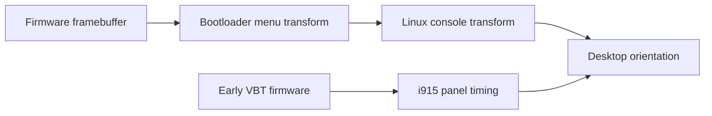

# Boot menu orientation and quiet startup

These are manual settings for an existing bootloader. `minibookx-ctl` does not
install a bootloader, change EFI entries or maintain boot files. The examples
come from one [U300 revision](../../docs/hardware/README.md); inspect your own
configuration and keep a working recovery entry before editing it.

## Which layer needs a change?

The panel is physically portrait-native. On the tested machine, its firmware
framebuffer is **1200 × 1920**, even when the image is viewed in landscape.
Forcing a 1920 × 1200 framebuffer stretched the menu. Rotation and framebuffer
resolution are separate settings.

| Stage | Configuration owner |
|---|---|
| Firmware logo and setup | System firmware |
| Boot menu | GRUB or Limine |
| Early Linux console | Kernel framebuffer console |
| Login screen and desktop | Display driver and desktop compositor |
| 50/60 Hz panel timing | i915's VBT firmware override, available early in boot |



A correctly rotated menu does not rotate Linux's console or fix the panel
timing. Conversely, a sideways menu does not establish that i915 is faulty.

## Panel mount orientation

The portrait-native panel's fixed mounting must be described correctly to DRM
so the compositor can interpret logical normal orientation. On this U300 the
kernel reports `Normal` without the manual hint, which can leave the desktop
sideways after unfolding even with Mutter 51.1. The standard kernel argument
for the tested mounting is:

```text
video=DSI-1:panel_orientation=right_side_up
```

It supplies the `Right Side Up` connector property. Mutter combines that
mounting with the desktop's logical orientation. The hint is independent of
refresh rate and can be used with stock 50 Hz timings and stock i915. It does
not require VBT installation or a rebuilt driver. It corrects orientation
metadata; it does not fix startup corruption, flicker or stripes.

This value is specific to the tested mounting. Preserve root-device, encryption
and other boot arguments, and check for conflicting `video=` settings. Append
the fragment rather than replacing the complete command line.

Use your boot integration's supported configuration mechanism. In GRUB, edit
the appropriate `/etc/default/grub` settings and regenerate the configuration
using the distribution's procedure. In Limine, extend the actual entry's
`cmdline`, or use the distribution generator's supported custom arguments.
The [persistent argument table](#kernel-arguments-and-refresh-profiles) applies
to this hint too; VBT inclusion is needed only for a refresh override. Generated
files can be overwritten by updates.

After reboot, inspect `panel orientation` using the read-only
`modetest -M i915 -c` query when available, then test the physical image before
and after folding. See [desktop requirements](../../docs/tablet-mode.md#sideways-display-after-unfolding)
for the separate Mutter fix. Reference:
[Linux's panel_orientation option](https://github.com/torvalds/linux/blob/32c52ec87d6245ee2d12ed5dd509e40062939b50/Documentation/fb/modedb.rst#L78-L80).

## Linux console

The framebuffer console has its own rotation setting. If it remains sideways,
the tested optional console argument is:

```text
fbcon=rotate:1
```

Check the console independently after reboot. This console setting does not
supply the DRM mounting metadata needed by GNOME. Boot-menu rotation remains a
separate bootloader setting below.

## Limine

Limine provides native interface rotation. In the configuration actually loaded
by the installed EFI executable, put these global options before the first menu
entry for the initial test:

```text
interface_resolution: 1200x1920
interface_rotation: 90
timeout: 5
quiet: no
```

`interface_rotation` accepts 0, 90, 180 or 270. Check the menu on your own panel;
a different mounting orientation may need the other quarter-turn. Preserve the
native portrait framebuffer dimensions.

With a nonzero timeout, quiet mode waits without showing the menu; pressing a
key reveals it. **Esc was tested with the one-second window.** A zero timeout
removes that window. Keep the menu visible during initial setup, then enable
quiet mode after confirming correct orientation, proportions and recovery:

```text
timeout: 1
quiet: yes
```

The quiet waiting screen remains black. Keep the existing main-kernel
`default_entry` and the generated entry blocks; the settings above change only
the interface. This visible-then-quiet sequence was used for the
[qualified installation](../../docs/hardware/README.md#hardware-qualification).

For the flat black menu used in the checked clean installation, remove the
existing `wallpaper` option and use these opaque text-background settings:

```text
term_background: 00000000
term_background_bright: 000000
```

The first byte of `term_background` is transparency (`00` is opaque); the
bright-background option takes RGB only. For an optional gray visible menu,
use `00222226` and `222226` instead. These colors apply to the revealed interface
and do not recolor the black quiet waiting screen. Keep any desired foreground
and palette settings.

Menu silence and Linux silence are separate. For example, `quiet loglevel=3`
reduces kernel output. Splash-screen support and userspace status messages
depend on the distribution. Check boot logs after a trial; a hidden menu does
not suppress every warning or error.

Find the configuration actually loaded by the EFI executable before editing:
another `limine.conf` can take priority. Follow the installed version's hash,
enrollment and Secure Boot rules. See the
[Limine configuration reference](https://github.com/limine-bootloader/limine/blob/v12.x/CONFIG.md).

On CachyOS, inspect `ESP_PATH` in `/etc/default/limine`, the mounted ESP and
`efibootmgr -v` before choosing a path. The checked clean installation loaded
`/boot/limine.conf`; `/boot/efi/limine.conf` belonged to an earlier layout.
Neither path is universal. Back up the active configuration before editing.

For early VBT firmware and 50/60 Hz entries, continue with the
[manual panel-timing guide](../../docs/display-driver-fix.md#manual-vbt-setup). Those kernel-side
requirements also apply to other bootloaders; only the image and entry syntax
differs.

## GRUB

GRUB's `GRUB_GFXMODE` selects a supported graphics mode; it does not rotate the
menu. `GRUB_GFXPAYLOAD_LINUX=keep` keeps that framebuffer mode for Linux; console
rotation is a separate setting. Inspect supported modes with `videoinfo`
at the GRUB command prompt before choosing one. See the GNU GRUB descriptions
of [gfxmode](https://www.gnu.org/software/grub/manual/grub/html_node/gfxmode.html)
and [gfxpayload](https://www.gnu.org/software/grub/manual/grub/html_node/gfxpayload.html).

The tested GRUB version required a custom framebuffer-rotation patch for a
landscape menu. That patch and custom EFI executable are **not maintained or
shipped here**. The standard graphics settings above do not rotate its menu.
Limine provides native rotation on the tested installation.

Use `efibootmgr -v` to inspect EFI entries and `BootCurrent`; compare their paths
with the files on the mounted ESP. A custom EFI filename is irrelevant if the
firmware boots a different path. A file copied over the ordinary EFI path may be
replaced by a bootloader update.

There is no universal `grub-install` or EFI-copy command in this guide. The
target path, signing and configuration-generation procedure belong to the
distribution and boot installation. Review them before replacing a loader.

## Kernel arguments and refresh profiles

Use these native configuration locations to persist kernel arguments, including
the mounting hint above. For a 60 Hz override, also include the selected VBT
through the normal [initramfs configuration](../../docs/display-driver-fix.md#5-include-firmware-early)
and add `i915.vbt_firmware=i915/chuwi-u300-60.bin`. The firmware argument changes
i915's selected table independently of the menu renderer.

| Integration | Persistent argument location | Regenerate |
|---|---|---|
| CachyOS / Arch GRUB | Existing `GRUB_CMDLINE_LINUX_DEFAULT` in `/etc/default/grub` | `sudo grub-mkconfig -o /boot/grub/grub.cfg` for that installed layout |
| Debian / Ubuntu GRUB | Existing kernel arguments in `/etc/default/grub` or local supported drop-in | `sudo update-grub` |
| Fedora GRUB with BLS entries | Use the distribution's `grubby` tool for selected kernels | Review `sudo grubby --info=ALL`; do not replace Fedora's EFI stub with generated grub.cfg |
| CachyOS Limine | Appropriate `KERNEL_CMDLINE[...]` in `/etc/default/limine` | `sudo limine-mkinitcpio` |
| Standalone Limine | Existing entry's `cmdline` in the actual `limine.conf` | Follow installed hash/enrollment rules and keep native image updates |

These are fragments to add, not complete command lines. Preserve root UUIDs,
encryption, resume and existing options. Fedora's `grubby --update-kernel` can
target one installed kernel for the first trial; consult its manual before
choosing `ALL`. Use the system's signing/UKI workflow if it differs from these
conventional layouts.

References: [Fedora GRUB configuration](https://fedoraproject.org/wiki/GRUB_2),
[grubby manual](https://github.com/rhboot/grubby/blob/main/grubby.8).

### CachyOS Limine: main 60 Hz and LTS 50 Hz

This is the tested arrangement with `linux-cachyos`, `linux-cachyos-lts` and the
native Limine integration already installed. First install the VBT file and add
its `FILES` drop-in from the
[manual display guide](../../docs/display-driver-fix.md#5-include-firmware-early).
Do not regenerate images yet. Edit `/etc/default/limine`, preserving its other
settings and the independent recovery files.

The following lines are templates: replace `<existing boot arguments>` with
the system's complete working arguments, including root device, encryption,
subvolume and resume options as applicable. Remove duplicate or conflicting
copies of the three added options. The kernel-specific line is a complete
replacement, not an addition to the default line:

```text
KERNEL_CMDLINE[default]="<existing boot arguments> video=DSI-1:panel_orientation=right_side_up fbcon=rotate:1 i915.vbt_firmware=i915/chuwi-u300-60.bin"
KERNEL_CMDLINE[linux-cachyos-lts]="<existing boot arguments> video=DSI-1:panel_orientation=right_side_up fbcon=rotate:1"
```

Keep the quotes around each complete value and replace the placeholder before
saving. Keep required arguments in both values. Kernel `quiet loglevel=3` can be added
to both for reduced console output; it is independent of Limine's quiet menu.
The LTS image may include the 60 Hz firmware file, but omitting its selection
argument keeps original 50 Hz timings.

Before rebuilding, check what the installed entry tool resolves. The version
tested here accepts a kernel name for this query:

```sh
sudo limine-entry-tool --get-cmdline linux-cachyos
sudo limine-entry-tool --get-cmdline linux-cachyos-lts
```

Confirm complete command lines and a 60 Hz firmware selection only for the main
kernel. If your version prints help or an error, inspect its help and use its
supported syntax before proceeding. Regenerate only the main kernel for the
first trial, leaving the LTS images unchanged:

```sh
sudo limine-mkinitcpio linux-cachyos
```

Inspect the main entry, its kernel/initramfs paths and the firmware inside its
referenced image. Keep the menu visible for the first boot and follow
[physical validation](../../docs/display-driver-fix.md#validation-and-rollback).
Once that boot passes, regenerate the LTS image through the same native tool:

```sh
sudo limine-mkinitcpio linux-cachyos-lts
```

Check both entries again: the main selects the 60 Hz VBT and LTS omits its
selection argument. Limine's `#` image digests are BLAKE2b-512, not SHA-512;
the native generator maintains them. Preserve Windows and other entries,
the default selection and your menu options. Do not hand-maintain copied kernel
paths or add a custom post-hook. Normal kernel updates use the installed native integration. See the
[CachyOS configuration guide](https://wiki.cachyos.org/configuration/boot_manager_configuration/)
for its configuration rules.

For a one-time 50 Hz fallback, edit a menu entry and remove only the
`i915.vbt_firmware` argument. GRUB uses `e`, then its displayed boot shortcut;
Limine uses its entry editor as documented by the installed version. Changes in
the menu editor apply only to that boot. A 50 Hz timing fallback can still show
the original startup corruption; preserve a separately clean recovery image.

## Updates and rollback

Keep a known working kernel, initramfs and any required VBT archive independently
of the files being changed. An extra entry pointing at the same overwritten
files is not an independent recovery path.

After a kernel or bootloader update, check the loaded EFI path, generated
entries, image paths, hashes and custom arguments before rebooting. Preserve the
distribution's native update integration. This project does not add a hook or
promise that copied menu entries track new images automatically.
