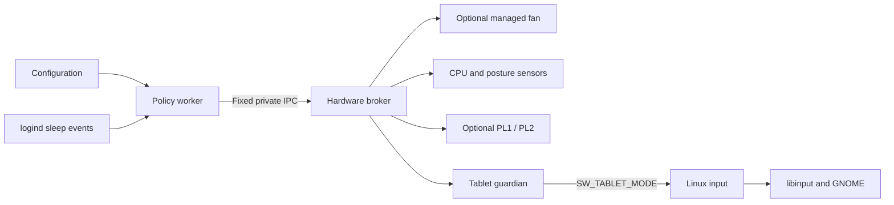
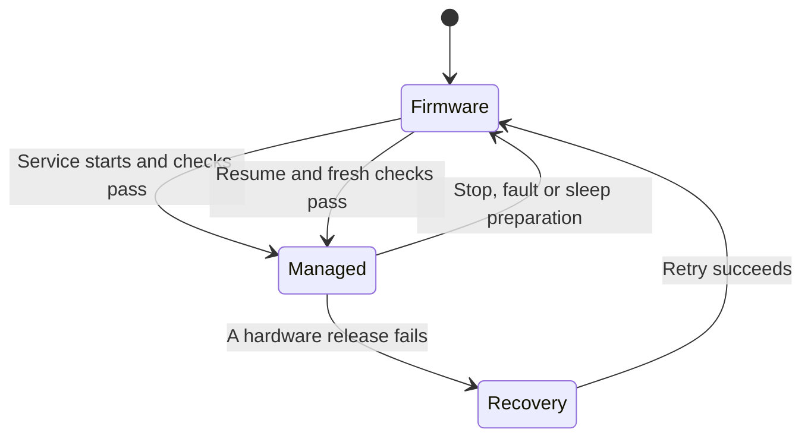

# How the service works

The service separates hardware access from configuration and fan policy. It runs
three single-threaded processes forked from the same executable, within one
systemd service:

| Process | Responsibility | Access |
|---|---|---|
| Hardware broker | Read temperatures/posture sensors, apply bounded fan and optional power requests | Fixed hardware interfaces; root |
| Policy worker | Parse config, choose fan targets, handle reloads and sleep events | Dedicated service user; no raw hardware descriptors |
| Tablet guardian | Keep the virtual tablet switch alive and send OFF during recovery | Its uinput descriptor; root |

The forked child closes hardware descriptors and drops its user, groups and
capabilities before becoming the policy worker, parsing config or connecting to
D-Bus. Configuration
can choose bounded settings, but cannot name commands, registers, device paths
or privileged hooks. systemd further restricts capabilities and writable paths.
See the [security model](../SECURITY.md) for the trust boundary.

After parsing configuration, the worker sends one fixed startup choice to the
broker. With `fan_control = false`, the broker does not prepare, open or access
the EC, and the worker does not require a CPU temperature sensor. Tablet and
optional power control retain their own checks. This choice cannot name a path
or register and is fixed until service restart; a reload cannot partially change
the startup mode. Earlier pending fan ownership must still be recovered.

Managed fan startup needs an existing debugfs mount. The unit exposes it through
a namespace-local bind under `/run/minibookx-ctl/hardware/`, a root-owned 0700
directory. This permits a late-created EC node while `/sys` remains protected.
The broker uses the alias only when its directory identity matches canonical
debugfs; standalone recovery can use the canonical path. The fixed EC backend
still restricts register access. The worker cannot traverse the private parent
and has neither hardware descriptors nor capabilities. Firmware fan mode does
not require debugfs or load the EC module; systemd can still establish the
optional namespace alias when its source exists.

## Why this approach

Tablet events use the standard Linux `SW_TABLET_MODE` interface. libinput disables
the built-in keyboard and touchpad, and GNOME handles touch mode and its on-screen
keyboard. The device-specific part is estimating posture from two accelerometers;
a working firmware/kernel tablet switch could replace it. See
[tablet mode](tablet-mode.md) for detection and its ambiguous positions.

When enabled, fan control uses the EC's manual duty interface. No supported way
to upload an autonomous fan curve is available, so the service reads temperature
and adjusts duty while awake. The [EC reference](hardware/ec.md) defines the
narrow write interface; the [BIOS guide](hardware/bios.md) explains the available firmware
settings. Neither fan control nor tablet detection requires firmware flashing.

## Sampling and fan decisions

With managed fan control enabled, the policy follows the
[configured curve and delays](configuration.md#fan-profiles).
With the shipped settings, it samples temperature every five seconds at stable
cold idle and every second while heating, holding or running the fan. Identical
config reloads preserve pending timers; profile changes preserve the emergency
latch and the actual fan run time.

The broker polls on a 250 ms bound. It reads posture at about 250 ms, CPU
temperature about once a second during manual control, and EC health about every
five seconds. The worker and broker have independent high-temperature guards.
The broker alone evaluates tachometer health and reports the result to the
worker; the worker cannot suppress that check while managed fan control is
active. In firmware fan mode there is no EC/tachometer or CPU-temperature polling.
Posture confirmation uses the same 250 ms sampling interval and discards pending
dwell after a gap longer than 750 ms.
The broker reports its applied duty and emergency state in each reply, including
when a repeated request caused no write. The worker uses that acknowledgement
to track fan starts and latch its own emergency policy. A broker-only heat pulse
therefore cannot bypass the policy's minimum run time; its timer starts
conservatively when the worker first observes the start.
Unchanged fan commands are not rewritten; sampling does not launch subprocesses.
Disabling tablet detection currently leaves the broker's polling bound unchanged.

## Recovery and sleep

Before manual control, the broker records ownership under
`/run/minibookx-ctl/`. Stop, failed health checks, lost workers or expired
heartbeats end manual operation. Cleanup restores fan control first and attempts
power and base-sensor restoration independently. Failed recovery keeps its
journals and required access for another attempt. The same unit invokes `--recover` through
`ExecStopPost`, including after startup failure. Before its next activation,
`--prepare` retries orphan recovery before creating a new ownership lease.
`Restart=on-failure` provides bounded retries under the unit's start-rate limit;
persistent recovery failure leaves the service failed and its records intact.

After a verified return to automatic fan control, the session retires its
`manual.owner` marker, including before suspend. It creates a new marker before
reactivating manual control. The module lease remains until final cleanup;
it is separate from current fan ownership.

For suspend, the worker uses a logind delay inhibitor. It requests firmware fan
control, power restoration, tablet OFF and base-sensor restoration before
releasing the inhibitor. Resume rechecks hardware and starts fresh policy timers;
it does not reuse the old duty
or count sleeping time as a temperature measurement. The service treats a D-Bus
disconnect or logind owner change as a fault.

Recovery needs a functioning kernel and recovery process; restoring a managed
fan also needs a reachable EC. Manual fan mode has
no demonstrated hardware timeout: userspace recovery cannot cover an unreachable
EC or a hung kernel. Returning control to firmware also resumes the firmware's
own fan algorithm; it does not establish an independent thermal safeguard.

### Tablet-switch recovery

The guardian owns the same virtual switch descriptor throughout operation.
When its broker connection closes or its awake heartbeat expires, it establishes
tablet OFF before removing the device, writing an event unless already known
OFF. This matters because device removal alone may leave input inhibited in
libinput.

An acknowledgement confirms that the switch is known OFF through that live
descriptor, not that the desktop consumed an event. The guardian cannot recover
after its own SIGKILL or an input-subsystem failure. The service and watchdog
use graceful SIGTERM before systemd's forced-kill deadline so ordinary shutdown
can send OFF.

### Base-sensor recovery

The supported base accelerometer may boot with CONTROL `01` (power-down) or
`00` (awake). After acquiring the hardware lock, the broker records `sensor.lease`
before changing `01` to `00`. It waits 500 ms and discards the first sample
before estimating posture. No reset, range or interrupt setting is changed.
An already awake sensor needs no write or recovery record.

Like the other records under `/run`, this ownership record lasts only for the
current boot. It supports process-failure recovery, not restoration after loss
of power or reboot.

The lease names a fixed hardware profile and original/applied bytes, never an
arbitrary bus, path or register. Recovery rediscovers the device and verifies
identity, ownership and current state before restoring `01`. A conflicting state
leaves the record for investigation. Sensor recovery also runs when startup
failed before the fan/module lease existed, and its failure does not skip fan
or power restoration.

Before sleep or normal shutdown, the live guardian must confirm tablet OFF
before the broker powers down a sensor it woke. Resume reacquires the sensor
and starts a new posture estimate. An I/O or identity failure clears tablet mode
and faults the service; invalid gravity samples use the estimator's stale-data
timeout. The unprivileged worker and guardian never inherit the I2C descriptor
or the hardware lock.

### Power-limit recovery

Optional PL1/PL2 writes use captured original values and a root-owned, within-boot
journal. The broker validates bounds, preserves PL1≤PL2 during two-file updates
and verifies readback. Recovery restores a value only when current state still
matches an expected state from the journal; conflicting external changes cause
a fault. Checks also precede rollback and each individual write. These sysfs
operations are not atomic with other writers: an external change after a check
can still race the write. Run only one power-limit controller.
The single unit allow-lists the package's fixed power-limit files.
Normal policy writes require `power_control = true` in the
[configuration](configuration.md#optional-package-power-limits).

The config opt-in controls normal policy; it is not a second security boundary
against a compromised worker. The broker independently enforces the fixed
package, named constraints, wattage bounds and recovery attribution on every
request.

## Config and status files

The worker accepts bounded regular config files and rejects duplicate/unknown
keys, symlinks, FIFOs, includes and commands. Directory watches handle normal
edits and atomic replacement. Invalid updates keep the last accepted policy.

`--status` combines separate policy, fan, power and tablet records. Its reader
checks
ownership, file type, links and size, then parses and reserializes JSON. This
keeps worker-controlled output from becoming a privileged file read or terminal
control sequence. The records update separately; their
[field meanings](diagnostics.md#service-status) distinguish policy requests,
broker-applied duty, captured power baseline and current RAPL observations.
