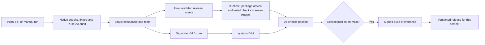

# Building and maintenance

For installation and updates, use the [prebuilt release](../guide/install.md).
This guide covers source builds, release artifacts and checks after system
updates.

## Build from source

Build as an ordinary user with the current stable Rust toolchain. Native checks
need GNU Make, a C compiler, pkg-config, libdbus development headers, Python 3.11+,
ShellCheck and systemd's unit-verification tools. Static builds also need a musl
C compiler, Meson, Ninja and binutils. These are development dependencies; the
installed controller does not need them.

Install the pinned Python checks in a virtual environment before running Make:

```sh
rustup toolchain install stable --profile minimal \
  --component rustfmt --component clippy --component rust-docs \
  --target x86_64-unknown-linux-musl
python3 -m venv .venv
. .venv/bin/activate
python3 -m pip install -r requirements-dev.txt
make check
make static-test
```

The executable is
`target/x86_64-unknown-linux-musl/release/minibookx-ctl`. The build script downloads
and verifies the pinned libdbus source, then builds its client library locally.
It uses a bundled source archive when building from the corresponding source
release.

Normal builds omit policy experiments. Enable the `dev-tools` feature for the
read-only [development commands](../reference/diagnostics.md#development-only-policy-tools).
`make check` tests both the production CLI and the optional tools; release
executables are built without development features.

`rust-docs` supplies the compiler's runtime license notices embedded in every
build; it is required even when you do not use Rust's local documentation.

The default C compiler is `musl-gcc`. A compatible compiler wrapper can be selected
explicitly:

```sh
CC_x86_64_unknown_linux_musl=/absolute/path/to/compiler-wrapper \
  make static-test
```

| Command | Purpose |
|---|---|
| `make format` | Format Rust source |
| `make check` | Ruff, Rust formatting, Clippy, Rust/Python tests including the VM fixture, unit checks, documentation links and ShellCheck |
| `make static-test` | Build and verify the static executable; run Rust tests including the fixture under musl |
| `make systemd-fixture` | Build and verify the separate static VM executable |
| `make distros` | Check prerequisites, package advice and staged/mocked-service installation in seven images across five distributions |
| `make package` | Package a clean commit and its matching static build into `dist/` |
| `make verify-release` | Check release assets against the current source commit |

`scripts/` contains the static-build driver, pinned libdbus source handling,
packaging, shared artifact validation and publication. `make` is their common
entry point. Tests and their fixtures live under `tests/`; the optional offline
panel builder stays with its manual feature under `contrib/vbt/`.

The build embeds the preset template, single systemd unit and license notices in
the executable. Rust runtime notices come from the compiler used for that build;
other notices come from `packaging/licenses/`. No network access or compiler is
used by the installed service.

## Real systemd lifecycle test

The container installer test substitutes `systemctl`. To test actual service
supervision, use the separate file-backed QEMU fixture in `tests/systemd/`.
It compiles the production broker, worker, IPC, service and logind code with fake
EC, temperatures, posture sensors and a file sink for tablet events. Hardware
session preparation and fan/module recovery use a file-only model rather
than the production `hardware.rs` implementation. The sensor uses production
lease/retain/restore code against a file-backed CONTROL byte. The shipped
systemd unit runs under real PID 1. The feature-gated fixture is not part of a
normal/release executable and refuses a host without its QEMU identity.

Prerequisites are Docker, QEMU and the static-build tools above. The Dockerfile
provides a Debian root filesystem and a prebuilt kernel from Debian's package
repository. KVM is the normal accelerator; `--accel tcg` is available when KVM
is unavailable. No host unit or physical device is changed; the guest has no
disk or network.

Build the fixture and guest, then run the suite in a fresh temporary directory:

```sh
make systemd-fixture
docker build -t minibookx-systemd-test - < tests/systemd/Dockerfile
task_vm_dir=$(mktemp -d -t minibookx-systemd.XXXXXX)
vm_container=$(docker create minibookx-systemd-test)
docker export --output "$task_vm_dir/rootfs.tar" "$vm_container"
docker rm "$vm_container"
tar -xOf "$task_vm_dir/rootfs.tar" boot/vmlinuz > "$task_vm_dir/vmlinuz"
python3 tests/systemd/run_vm.py \
  --kernel "$task_vm_dir/vmlinuz" \
  --rootfs "$task_vm_dir/rootfs.tar" \
  --fixture target/x86_64-unknown-linux-musl/release/minibookx-systemd-fixture \
  --output "$task_vm_dir/results"
```

Use `CC_x86_64_unknown_linux_musl` with `make systemd-fixture` if using a compiler
wrapper. A failed export needs cleanup with `docker rm` for the container just
created. Review `results/result.json` and `results/serial.log` inside
`$task_vm_dir`; a pass requires the guest assertions and successful VM exit.

The suite checks start/stop/restart, the sandbox and privilege drop, real logind
authorization, worker/broker loss, systemd watchdog handling, `ExecStopPost`,
tablet OFF and recovery-record retention after an injected restoration fault.
It also checks hot takeover, tablet-domain failures, worker notification
spoofing, real device-filter enforcement and a failed update rolled back by the
production installer against real systemd. Status tests cover I/O errors and
recovery of the latest fan/power/disabled-tablet snapshots without EC access.
Stalled-guardian checks cover final cleanup, the pre-sleep Restore request and
sensor failure. Stop and sleep release cooling before waiting for OFF. A sensor
fault first attempts a bounded OFF to disable only tablet detection; failed OFF
enters service cleanup. Sensor restoration always waits for confirmation.
Fan-disabled cases start without debugfs, EC or CPU-temperature files, exercise
profile reload and reject a changed startup flag. A guest-only fake debugfs
source checks late EC-file creation through the unit's real private bind.
It does not validate physical PWM, real sensor orientation, RAPL writes,
production fan/module lease guards, libinput consumption, panel output or
suspend hardware. Those checks remain separate from the VM. A logind sleep
cycle uses a guest-only three-second sleep service, not physical S3. The suite
uses the production twenty-second watchdog; only the repeated-forgery scenario
shortens it to six seconds to distinguish manager rejection from the broker's
policy timeout.

The suite also checks lid-event integration and descriptor
isolation, bounded sampling under early wakes, diagnostic command suppression,
fanless/no-tablet operation and thermal protection with a stopped worker.
It kills the guardian and checks OFF through the retained original descriptor,
tests sensor restore failure across logind pause/resume and discovery backoff,
and rejects heartbeat-only policy and repeated forged worker watchdog messages.
It covers the fake hardware model and
namespace mechanics above, not real late loading of `ec_sys`. Re-run the suite
after relevant changes; it does not qualify a new build on the physical laptop.

### Evidence boundaries

| Check | What it validates |
|---|---|
| Rust tests with fake backends | Policy, parsing, bounds, errors and recovery decisions |
| Distribution containers | Prerequisite installation, reports, account/config validation, mocked installer sequencing and GPU package metadata/solver checks |
| QEMU with systemd PID 1 | Real process supervision, sandbox/logind and lifecycle against a file-only fan/module session and recovery model; production sensor-lease code on a file-backed CONTROL byte |
| Documented U300 observations | Physical behavior of the recorded software/device combination only |

Physical support and its limits are summarized in the
[hardware reference](../hardware/README.md#features-and-limits).

The disposable CachyOS container disables its pacman's nested network-namespace
sandbox so package hooks can run under Docker's restricted capabilities.
Signature checks and the remaining package sandbox stay enabled. This test-only
setting is never installed on a user's system.

Re-run the relevant checks after material changes. A VM pass does not qualify a
new binary on the laptop. Physical results apply only to the tested build; live
RAPL writes need their own qualification.

### Distribution matrix

`make distros` uses these disposable images:

| Distribution | Image |
|---|---|
| Debian 13 | `debian:13-slim` |
| Ubuntu 24.04 | `ubuntu:24.04` |
| Ubuntu 26.04 | `ubuntu:26.04` |
| Fedora 43 | `fedora:43` |
| Fedora 44 | `fedora:44` |
| Arch | `archlinux:base` |
| CachyOS | `cachyos/cachyos:latest` |

Checks install runtime prerequisites, run reports, and exercise account/config
validation, staged updates and removal with mocked service control. GPU checks
query candidate metadata and request solver-only transactions; they do not install
GPU packages. APT media alternatives are checked; Fedora uses its native stack.
RPM Fusion transactions, codec coverage and real playback are not qualified.
Python and diffutils are test tools, not runtime dependencies.

## Release files and versions

```sh
minibookx-ctl --version
minibookx-ctl --build-info
```

The release version comes from `Cargo.toml`. Each published release increments
its version, with the matching change in `Cargo.lock`. Version `X.Y.Z`
uses commit title **`Release (vX.Y.Z)`**, tag **`vX.Y.Z`** and GitHub release title
**`Release (vX.Y.Z)`**. Tags use a `v` prefix and no hash suffix.

The executable reports `X.Y.Z+g<commit>`, using the source commit's first
12 characters. Asset filenames keep the same build identity; metadata records
the full commit, compiler and static libdbus identity. Make the final commit
before building: changing even its message changes the hash and requires a new
build.

Each release contains five assets:

| Asset | Contents |
|---|---|
| `minibookx-ctl-x86_64-linux` | Static executable used by the bootstrap |
| `minibookx-ctl-X.Y.Z-<commit>-x86_64-unknown-linux-musl.tar.gz` | Executable, bootstrap script, configuration template, service, documentation, panel tools and notices |
| `minibookx-ctl-X.Y.Z-<commit>-sources.tar.gz` | Corresponding source, locked Cargo dependencies and pinned libdbus source |
| `build-metadata.json` | Build and source identity |
| `SHA256SUMS` | Checksums of the other four assets |

Packaging requires committed source and a binary built from that exact clean
commit. The read-only developer tool checks the artifacts without executing
their binary:

```sh
make verify-release
```

Use `RELEASE_DIR=/path/to/assets` and `COMMIT=full-commit` when checking another
release. `make help` lists the supported developer commands.

Python release tooling is not part of installation. The bootstrap resolves
`latest` once, validates that it names a tag in this repository, and downloads
that tag's executable and checksums.

Pushes to `main`, pull requests and manual runs execute checks without publishing
by default. Do not use CI-skip commit markers for documentation or code changes.
The systemd VM runs alongside the seven container suites after the checked
artifacts are ready. The [distribution matrix](#distribution-matrix) lists the
container versions and scope.

Every run keeps its evidence for 14 days. `linux-x86_64-musl` holds the tested
static executable with its archives, metadata and checksums; it is uploaded only
after the native checks, the RustSec advisory check, musl tests, VM fixture
build and packaging pass. `systemd-fixture` holds the separate VM executable.
`logs-check-and-build` and `logs-distro-<name>` hold the command output of each
job, including failed runs, and `systemd-vm-results` holds the VM's assertions
and serial log.

The `Required CI checks` ruleset protects `main`. It requires a pull request,
the build, systemd VM and seven distribution jobs, without bypasses. Direct
updates, force-pushes and deletion are prohibited. Push a review branch and
open a pull request to start the required CI. Manual workflow runs remain
available for additional checks; they do not replace the required PR.
Merge only after all nine checks pass. Keep the ruleset's required job names in
sync with the matrix.

To publish, bump the version in the release PR and squash it with commit
title `Release (vX.Y.Z)`. Squashing changes the commit hash; the final assets must
be built from the resulting main commit. A release that changes fan policy or
takeover first needs the supervised sustained-load, hot-start and hot-resume
checks in [AGENTS.md](../../AGENTS.md#documentation-and-releases).
Run **Check, build and release** on `main` with its **publish** checkbox
enabled, or use:

```sh
gh workflow run ci.yml --ref main -f publish=true
```

That run repeats all checks and publishes only if native checks, the RustSec
advisory check, static tests, artifact validation, the VM and all container
suites pass. Before publication,
a separate job without repository write access signs SLSA build provenance for
the checked files; publication does not start if signing fails. Ordinary commits do
not require a version bump; `main` may contain unreleased changes. The public
installer downloads the latest published release and preserves existing config.

Published versions are append-only by project policy:
retrying the exact same build can verify and resume it, but a different commit
cannot reuse its tag or replace its assets. A new release must use a new version.
The README runs `install.sh` from `main`, and the script selects the latest
published release. Keep `install.sh` on `main` able to install that release's
assets; publish a release before merging a bootstrap change that depends on it.
The publisher checks that GitHub locked the published release, including on
retries. Version tags cannot be updated or deleted; fresh tags can be created.
The repository setting is managed separately;
CI does not receive an administration token. CI-skip markers can prevent GitHub
from starting a workflow, so the required branch checks enforce the policy
rather than a step inside that workflow.



The source archive records its compiler in `BUILD-TOOLCHAIN.txt`. Future stable
Rust versions may produce different bytes from the same source. Security updates
to a static dependency require a new executable; updating the host's shared
libdbus does not update the library linked into an existing release.

## After kernel, BIOS or firmware updates

Keep a working boot entry. Before relying on unattended control:

1. Start the service and inspect `--doctor`, `--status` and its journal.
2. Stop it and confirm that firmware fan control returns.
3. Start it again and check the selected profile and observed power limits.
4. Fold and unfold the laptop; check keyboard, touchpad and screen orientation.
5. Close and open the lid; check the expected sleep/wake behavior.
6. Suspend and resume; check input and fan control again.
7. With the 60 Hz setup, follow its
   [BIOS-update step](../guide/display.md#what-to-expect-afterwards).

If detection fails, leave the service stopped and compare the device with the
[supported hardware](../hardware/README.md). Do not bypass a revision check to make
the service start. The same unit runs recovery after a stop or failure and
before a restart.

Display modifications are maintained separately:

| Change | Manual guide |
|---|---|
| VBT timing and early firmware | [Display setup](../guide/display.md) |
| i915 timeout investigation | [Unbuilt developer RFC](../../contrib/i915/README.md) |
| Boot menu and console orientation | [Boot settings](../guide/boot.md) |
| GNOME rotation behavior | [Tablet mode](../guide/tablet-mode.md) |

Start with the [stock-driver 60 Hz setup](../guide/display.md) on the tested
panel. The supplied RFC is not a verified replacement module. Any independently
qualified replacement must match the distribution
kernel's exact source, configuration, headers, toolchain requirements and signing
policy. Repeat the manual module checks and review boot entries after a kernel
update. Installing or updating minibookx-ctl does not build a module, install
a rebuild hook or refresh boot files.
