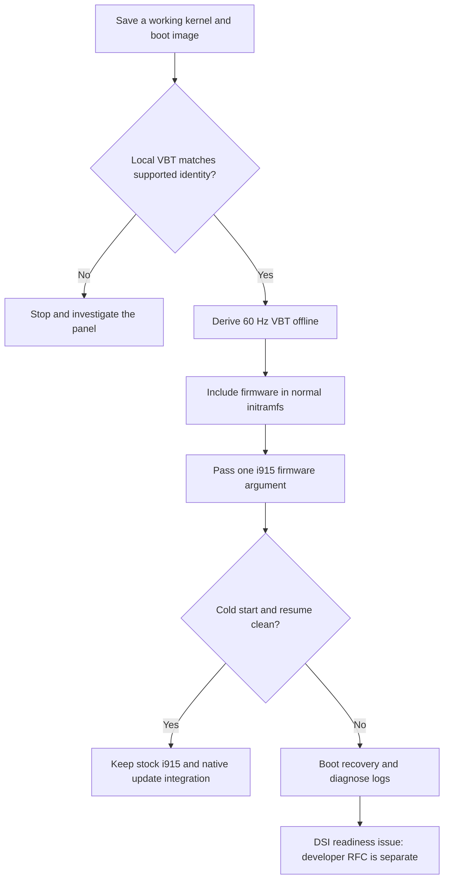

# Panel timing and startup corruption

These are optional manual changes for the [documented U300 panel](hardware/README.md).
The controller installs no VBT, driver patch, initramfs hook or boot entry.

On that panel, **try experimental 60 Hz with stock i915 first**. It removes the
50 Hz / 60 fps cadence mismatch. The verified installation and its cold-start
and S3 checks are recorded in the [hardware qualification](hardware/README.md#hardware-qualification).
This is not a universal DSI fix: the panel part number and rated maximum refresh
are unknown. Do not select a different BIOS panel type to imitate these results.



## Refresh rates

| Mode | Evidence on one panel | Intended use |
|---|---|---|
| 50 Hz | Original firmware timings; startup corruption observed with stock i915 | Timing fallback, not a guarantee of clean startup |
| 59.94 Hz | Boot and S3 passed with a downstream patched driver | Optional experimental timing; stock-driver qualification is separate |
| 60 Hz | Stock-driver setup checked on the matching panel; see [qualification](hardware/README.md#hardware-qualification) | First experimental option on the matching panel |
| Above 60 Hz | 70 Hz corrupted physical output | Unsupported; no profile supplied |

Select the timing at boot. This project supplies neither live GNOME switching
nor variable refresh. A screenshot cannot validate the physical link.

### Why GNOME shows only one refresh rate

On Linux 7.2.11, this MIPI-DSI connector exposes one fixed timing selected from
VBT when i915 initializes. Loading the 60 Hz VBT replaces the selected 50 Hz
timing; it does not add a second item to GNOME's refresh menu. Other VBT panel
slots describe alternative panels, not additional refresh choices.

The driver rejects a requested refresh that differs from its fixed timing.
GNOME can select available modes, but a desktop setting or modeline cannot
provide the missing physical 50 Hz mode on this path. Supporting both rates
live would require driver work, including correct DSI clock handling for each
mode. The documented 50 Hz fallback requires a reboot.

References: [DSI initialization](https://github.com/gregkh/linux/blob/v7.2.11/drivers/gpu/drm/i915/display/icl_dsi.c#L1992-L2003),
[fixed-mode validation](https://github.com/gregkh/linux/blob/v7.2.11/drivers/gpu/drm/i915/display/intel_panel.c#L397-L423).

### What changes

VBT describes the panel to i915. The offline builder changes pixel clock and
checksum, preserving resolution, blanking totals, RGB888, four DSI lanes and
panel commands. For fixed totals, refresh is pixel clock divided by horizontal
total and vertical total.

| Mode | Pixel clock | Horizontal total | Vertical total |
|---|---:|---:|---:|
| Original 50 Hz | 138267 kHz | 1272 | 2174 |
| 59.94 Hz | 165754 kHz | 1272 | 2174 |
| 60 Hz | 165920 kHz | 1272 | 2174 |

Changing pixel clock also affects escape-clock timing on this configuration.
Successful stock-driver boot is an observation, not a measured readiness latency
within exactly 2500 µs: the polling helper can read after its nominal deadline.
Generic modelines, lower color depth and unrelated LVDS settings are not a
substitute for a validated panel configuration.

## Manual VBT setup

You need Python 3 and the offline builder in `contrib/vbt/`. To obtain it without
Git or a compiler, [download, verify and extract the Linux release archive](../packaging/manual-install.md#1-download-and-check-a-release).
You can stop that manual-install guide after extraction: no account creation or
file-copy installation is needed to use the builder. The one-line controller
installer downloads only its executable; it does not install these panel tools.
An existing source checkout also contains the builder.

The builder prepares ordinary files. The following steps install them through
your existing boot setup; they do not rebuild i915 or flash firmware.

### 1. Preserve a recovery path

Save the working kernel, initramfs, any required firmware and their boot entry on
independent files. A duplicate entry using images you are about to overwrite is
not recovery. Keep boot media and the boot menu accessible during the first test.
Check which ESP/configuration the machine actually boots.

If a local patched driver is required for the current working image, preserve it.
Original 50 Hz timings alone may still have the startup fault. Do not erase the
last clean image while testing stock i915.

### 2. Capture and verify the local table

Reading the VBT needs a mounted debugfs; use the
[manual mount check](distributions.md#mount-debugfs-when-needed) if it is absent.
This display procedure does not require `ec_sys` or a running controller.

Keep the captured table and generated firmware in a private directory outside
the checkout. The example creates `~/minibookx-panel`; choose another name if it
already exists. Replace `/path/to/minibookx-ctl` with your extracted release or
checkout's actual path. The i915 debugfs directory may also need adjustment for
your kernel:

```sh
cd ~
mkdir -m 0700 minibookx-panel
cd minibookx-panel
umask 077
sudo cat /sys/kernel/debug/dri/0000:00:02.0/i915_vbt > local-u300.vbt
python3 /path/to/minibookx-ctl/contrib/vbt/build_vbt.py \
  --input local-u300.vbt --output generated-vbt
```

The builder accepts only complete known VBT identities. It writes a new local
directory, not the running display or flash. A rejection needs investigation;
do not weaken the check because the laptop name or resolution matches.
Keep captured firmware private and outside the repository.

| Output | Contents |
|---|---|
| `chuwi-u300-60.bin` | 60 Hz override |
| `chuwi-u300-59-94.bin` | Optional 59.94 Hz override |
| `manifest.json` | Input identity, checksums and timing differences |
| `vbt-modes.cpio` | Alternative early archive for bootloaders accepting additional initrds |

Review the manifest before installing a file. This guide uses the `.bin` file
and the distribution's normal initramfs; leave `vbt-modes.cpio` unused.

### 3. Install the selected firmware

If the destination exists, compare its checksum and resolve unexpected content
before replacing it. For the 60 Hz profile:

```sh
sudo install -Dm644 generated-vbt/chuwi-u300-60.bin \
  /usr/lib/firmware/i915/chuwi-u300-60.bin
```

The examples use 60 Hz. If deliberately testing 59.94 Hz, use
`chuwi-u300-59-94.bin` consistently in the install path, boot argument and
initramfs configuration.

### 4. Select the firmware in the boot arguments

Add this argument to the test entry, keeping its root, encryption, microcode
and other existing options:

```text
i915.vbt_firmware=i915/chuwi-u300-60.bin
```

The path is relative to the kernel firmware directory. Use your loader's
[GRUB or Limine instructions](../contrib/bootloaders/README.md#kernel-arguments-and-refresh-profiles)
to make it persistent. Keep the independent recovery entry, and do not reboot
until the firmware has been included in the next step.

To select stock 50 Hz timings, omit this argument. The installed firmware file
is used only when selected; it can stay on disk. Separate 50/60 Hz entries must
follow the loader's normal updates rather than depend on copied static image
paths. Remember that 50 Hz alone did not guarantee a clean startup on this panel.

### 5. Include firmware early

i915 can start before the root filesystem is available, so a file under
`/usr/lib/firmware` also needs to be in the boot image. Choose **one** section
matching the initramfs tool already used by your system.

Keep that system's normal UKI, ESP-copy, signing and entry-generation procedure.
The inclusion mechanisms below have been checked with test files, but they have
not all been used for a physical boot on this laptop.

#### mkinitcpio: Arch and CachyOS

On the tested CachyOS installation, create
`/etc/mkinitcpio.conf.d/60-minibookx-panel.conf` containing:

```sh
FILES+=(/usr/lib/firmware/i915/chuwi-u300-60.bin)
```

This ordinary configuration drop-in preserves the existing arrays and hooks.
If an older mkinitcpio lacks drop-in support, append the path to the existing
`FILES` array in `/etc/mkinitcpio.conf` instead. Use one inclusion method.

With ordinary Arch boot integration, regenerate using `sudo mkinitcpio -P`.
With CachyOS's installed Limine integration, first configure the
[main 60 Hz and LTS 50 Hz arguments](../contrib/bootloaders/README.md#cachyos-limine-main-60-hz-and-lts-50-hz),
then regenerate only the main kernel for its initial trial:

```sh
sudo limine-mkinitcpio linux-cachyos
```

Use the actual installed kernel name. Keep the independent recovery image
unchanged until the main boot passes. The boot guide then shows the separate
LTS regeneration. `sudo limine-mkinitcpio` without a package regenerates all;
do not use that form for a main-only first trial.
The native generator updates image copies and entry hashes.
Inspect the image referenced by the generated entry with
`lsinitcpio /absolute/path/to/initramfs`; it must list the named firmware.
No separate VBT initrd, custom post-hook or copied static kernel entry is needed.

References: [mkinitcpio.conf](https://man.archlinux.org/man/mkinitcpio.conf.5.en),
[CachyOS native regeneration](https://github.com/CachyOS/wiki/blob/next/src/content/docs/configuration/general_system_tweaks.mdx).

#### dracut: Fedora and other dracut installations

Create `/etc/dracut.conf.d/60-minibookx-vbt.conf` containing:

```sh
install_items+=" /usr/lib/firmware/i915/chuwi-u300-60.bin "
```

Choose the installed kernel you intend to test, then regenerate through its
normal integration. On a conventional Fedora image layout:

```sh
kver=$(uname -r)
sudo dracut --force --kver "$kver"
lsinitrd "/boot/initramfs-$kver.img"
```

Replace the inspection path if your system uses a different image or a UKI.
Verify that the named firmware is in the image actually referenced by the boot
entry; a successful command that rebuilt another image is insufficient.

Reference: [dracut configuration](https://github.com/dracut-ng/dracut-ng/blob/main/man/dracut.conf.5.adoc).

#### initramfs-tools: Debian and Ubuntu

Create `/etc/initramfs-tools/hooks/minibookx-vbt` with this build-time inclusion
hook. It copies one file; it does not patch a driver or run at system startup:

```sh
#!/bin/sh
set -eu
case "${1:-}" in prereqs) exit 0 ;; esac
. /usr/share/initramfs-tools/hook-functions
copy_file firmware /usr/lib/firmware/i915/chuwi-u300-60.bin \
  /lib/firmware/i915/chuwi-u300-60.bin || [ "$?" -eq 1 ]
```

Make the reviewed hook executable and rebuild the intended target:

```sh
sudo chmod 0755 /etc/initramfs-tools/hooks/minibookx-vbt
kver=$(uname -r)
sudo update-initramfs -u -k "$kver"
lsinitramfs "/boot/initrd.img-$kver"
```

Check that the output lists the firmware at the kernel's firmware path.
The hook remains in place for normal future image generation.
The final check accepts the helper's “already copied” result while retaining
failure for missing files or copy errors. References:
[initramfs-tools hooks](https://manpages.debian.org/trixie/initramfs-tools-core/initramfs-tools.7.en.html),
[Debian hook helpers](https://sources.debian.org/src/initramfs-tools/0.148.4/hook-functions/).

## Validation and rollback

After a full power-off and button start, inspect the physical screen before any
sleep cycle. Check the active refresh while the screen is on, play 60 fps video,
and then test suspend/resume and input:

```sh
minibookx-ctl --doctor
sudo journalctl -k -b --no-pager | grep -Ei 'i915|dsi|vbt'
cat /sys/power/mem_sleep
```

The selected sleep mode appears in brackets; verify an actual `deep` entry when
comparing with the documented S3 result. A clean screenshot or journal alone
cannot establish clean panel output.

For rollback, boot the independent recovery entry or remove the firmware
argument once in the menu editor. Then remove its persistent argument and local
inclusion configuration, regenerate the relevant images and verify entries.
Remove only unreferenced local files. Restoring 50 Hz can restore startup
corruption too; keep the clean recovery combination until the new setup passes.

After kernel/initramfs updates, check firmware inclusion and generated arguments.
With the native configuration above, normal generators carry those settings
forward; the controller adds no new boot-file maintainer.

The [hardware qualification table](hardware/README.md#hardware-qualification)
records the checked setup and its limits. Successful tests on one panel do not
establish long-term cold-start reliability or physical support on other
distributions. Older 59.94 Hz tests used a patched driver.

## DSI readiness investigation

If corruption persists, return to recovery and collect the kernel log and exact
module identity. The [i915 developer RFC](../contrib/i915/README.md) describes an
optional readiness deadline override. That exact candidate is unbuilt and
unqualified; no verified user patch is shipped. A driver investigation remains
separate from panel timing and from the controller.

## Rotation

Boot menu, console and desktop orientation are separate. Use the
[bootloader guide](../contrib/bootloaders/README.md) for preboot/console settings,
and [desktop integration](tablet-mode.md#sideways-display-after-unfolding) for
orientation after unfolding.
