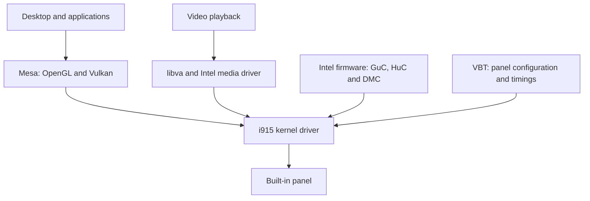

# Graphics and display

`minibookx-ctl` handles the fan, power profiles and tablet switch. Graphics use
the distribution's Intel drivers. Display fixes are separate, optional changes;
controller installation does not apply them. Follow the manual guides below
for your exact kernel, panel and bootloader.

## Choose the right fix

| Problem | What to check | Guide |
|---|---|---|
| Corrupted display after boot, cleared by sleep and wake | Try matching-panel 60 Hz with stock i915; investigate DSI readiness if it persists | [Panel setup](display-driver-fix.md); [developer-only RFC](../contrib/i915/README.md) |
| Uneven playback of 60 fps video on the stock 50 Hz mode | Panel refresh rate | [Display modes](display-driver-fix.md#refresh-rates) |
| Display stays sideways after unfolding | DRM panel mounting and Mutter's logical-orientation fix | [GNOME integration](tablet-mode.md#sideways-display-after-unfolding) |
| No automatic rotation or on-screen keyboard | Tablet switch, rotation lock and GNOME session | [GNOME integration](tablet-mode.md) |
| Sideways boot menu or early console | Bootloader and framebuffer rotation | [GRUB and Limine](../contrib/bootloaders/README.md) |

The supported hardware and distribution packages are listed in the
[hardware table](hardware/README.md). Update the kernel, Mesa, Intel firmware
and media driver through the distribution's package manager. The
[distribution guide](distributions.md#intel-graphics-and-hardware-video-decoding)
lists the runtime and optional Intel packages for each distribution.

## How the graphics stack fits together



Mesa provides rendering drivers; libva and the Intel media driver provide
hardware video decoding. An application still has to use a supported decoding
path. `vainfo` lists available capabilities, but does not show whether a browser
is using them for the current video.

## GuC, HuC and idle power

Keep i915's automatic firmware selection unless a specific driver issue requires
an override. On the supported installation, GuC and HuC are already running,
DMC is loaded and RC6 render idle is enabled. Adding `i915.enable_guc=3` is not
an additional setup step for this machine.

GuC scheduling, HuC media support and DMC display power have different roles.
None changes the panel's DSI readiness deadline or refresh rate. The controller
installs no firmware-loading override.

References: [kernel i915 documentation](https://docs.kernel.org/gpu/i915.html),
[Mesa drivers](https://docs.mesa3d.org/systems.html),
[Intel media driver](https://github.com/intel/media-driver).

## Framebuffer compression (FBC)

FBC can reduce display memory traffic, but the active framebuffer format must
be supported. On this installation, GNOME uses **XR30**, a 10-bit-per-channel
buffer, and i915 reports `FBC disabled: pixel format not supported`. The panel
link still uses RGB888; compositor buffer depth and link depth are separate.

Forcing `i915.enable_fbc=1` does not add support for XR30. Changing GNOME's buffer
selection would require a separate workaround, and no battery benefit has been
established for it. FBC is therefore left at the driver's automatic setting.

The format checks are in
[i915's FBC implementation](https://github.com/torvalds/linux/blob/master/drivers/gpu/drm/i915/display/intel_fbc.c).

## Read-only diagnostics

Start with `minibookx-ctl --doctor` for OS-specific package advice and Intel
driver binding. It makes no changes and does not certify accelerated playback.

Use the following additional tools when investigating a graphics problem.
Debugfs paths and DRM card
names can differ between kernels; adjust the path if needed.

```sh
lspci -nnk -s 00:02.0
cat /sys/module/i915/parameters/enable_guc
sudo cat /sys/kernel/debug/dri/0000:00:02.0/gt0/uc/guc_info
sudo cat /sys/kernel/debug/dri/0000:00:02.0/gt0/uc/huc_info
sudo cat /sys/kernel/debug/dri/0000:00:02.0/i915_fbc_status
sudo cat /sys/kernel/debug/dri/0000:00:02.0/i915_display_info
vainfo
```

Check display timing while the screen is on. A screenshot captures rendered
content; it cannot establish the physical panel's refresh rate or show every
link-corruption problem.
