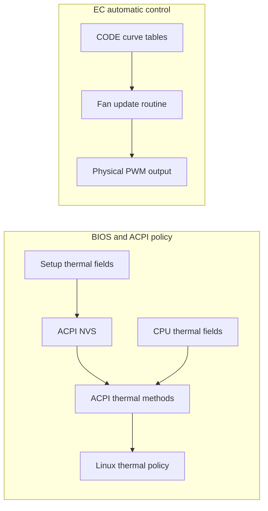

# BIOS settings

The paths below apply to the BIOS listed in the [hardware table](README.md).
`Main → Debug Mode` reveals additional setup pages. It changes menu visibility;
it does not unlock a documented EC programming interface.

These settings are optional. The controller works without changing them and
never writes BIOS variables. Before changing a setting, record its original
value and make one change at a time. Check the effective result after both boot
and resume: a visible Intel reference-platform option may have no useful
implementation on this board.

The catalogue is a read-only reference, not a raw-NVRAM editing guide. A tested
recovery procedure for a non-booting board or lost panel output is not available
here. Do not change panel selection, voltage, memory training or flash locks
without a model-specific recovery method. Loading Setup defaults is useful only
while Setup remains reachable; it is not a guaranteed recovery from these faults.

## Can BIOS replace the workarounds?

| Goal | Relevant setting | Current recommendation |
|---|---|---|
| Native tablet detection | IUER Slate Enable | Keep the daemon's detector; no working hinge-event source is established |
| Quiet automatic fan curve | Active Trip Point / fan-speed fields | Use daemon profiles; these fields are not a verified editor for the EC curve |
| Correct firmware screen direction | Screen Rotation Policy | Relevant only to preboot presentation; keep a known-good setting |
| Fix boot artifacts or enable 60 Hz | Graphics / LCD fields | Use the separate [display guide](../guide/display.md); no applicable readiness-timeout or panel-clock editor is established |
| Stop charging at 90% | Charging Method | Unsupported; Normal/Fast Charging is not a charge ceiling |

## CPU power limits

Open `Advanced → Power & Performance → CPU - Power Management Control`.
The table gives each setting's location within that page.

PL1 controls sustained package power. PL2 allows higher short-term package power;
the averaging window and other CPU protections still apply. Neither value
guarantees a clock speed. Higher limits can increase temperature and fan noise
without improving a workload that is already limited elsewhere.

| Setting | Location | Purpose | When to change it |
|---|---|---|---|
| Power Limit 1 Override / Power Limit 1 | View/Configure Turbo Options | Override sustained package power | To choose a deliberate sustained power budget |
| Power Limit 1 Time Window | View/Configure Turbo Options | Set the package-power averaging window | When measuring sustained behavior; it is not a guaranteed PL2 timer |
| Power Limit 2 Override / Power Limit 2 | View/Configure Turbo Options | Override short-term package power | To limit bursts, or after establishing cooling headroom for a higher budget |
| Package Power Limit MSR Lock | View/Configure Turbo Options | Restrict later package-limit changes | Preserve the BIOS policy; a lock may prevent optional OS overrides, but the daemon never unlocks it |
| Platform PL1 / PL2 Enable | Main CPU power-management page | Control separate platform limits | Keep the firmware policy unless deliberately tuning platform power |
| Power Limit 3 controls | Power Limit 3 Settings | Additional power limiting | Leave at firmware defaults; no tested tuning recommendation |
| Power Limit 4 Override / Lock | Main CPU power-management page | Fast electrical/current protection | Keep the firmware policy; this is not a sustained cooling target |

**Package PL1/PL2 BIOS fields use milliwatts:** `15000` means 15 W. A saved value
of `0` selects a firmware value; it does not mean zero power. Other power fields
may use different units. The setup input range also does not establish what
this CPU will accept.

For example, an explicit 15 W package limit would use `15000` in a BIOS field
that accepts milliwatts, while the daemon's config uses `15`. Choose one policy
owner: if using daemon profiles, follow
[optional package power limits](../guide/configuration.md#cpu-power-limits)
instead of layering unmeasured BIOS overrides and other power daemons.

The tested laptop explicitly defines PL1/PL2 in BIOS. With the default
`power_control = false`, the controller preserves that firmware/system policy.
The configuration word `firmware` means captured RAPL before an override, not
a direct BIOS Setup read. See [power diagnostics](../reference/diagnostics.md#reading-power-diagnostics)
for the distinction between saved values, current readings and enforcement.

The parent CPU power-management page also offers `C states` and `Package C State
Limit`. C states allow lower-power idle operation. A deeper allowed package state
does not prove the machine reaches it; compare actual residency and check resume
before treating a deeper selection as an improvement.

## Fan and thermal settings

Open `Advanced → Thermal Configuration → Platform Thermal Configuration`.

| Setting | What it controls | Practical limit |
|---|---|---|
| Active Trip Point 0/1 and fan percentages | ACPI active-cooling policy fields | No verified connection to the physical EC fan curve |
| CPU Temp / CPU Fan Speed | A firmware-described fallback for an OS hang | No demonstrated independent takeover while EC manual mode is active |

The EC's automatic curve is stored separately; see
[firmware fan curve](ec.md#firmware-fan-curve). For quieter operation,
use the [fan profiles](../guide/configuration.md#fan-profiles), which have explicit PWM
bounds and recovery behavior.

### How these fields reach Linux

The BIOS copies the thermal fields from `Setup` into ACPI NVS memory. The
inspected ACPI methods then use that policy. These are separate address spaces;
neither the variable offsets nor the NVS offsets are EC register addresses.

| `Setup` field | Offset | ACPI NVS destination | Consumer |
|---|---:|---|---|
| Active Trip Point 1 | `0x6B7` | `ACT1`, offset `0x0E` | `_AC1`; `_AC2` through `_AC4` subtract 5, 10 and 15°C |
| Active Trip Point 0 | `0x6B8` | `ACTT`, offset `0x0F` | `_AC0` fallback |
| Fan speed 1 / 0 | `0x6B9` / `0x6BA` | `AC1F` / `AC0F`, offsets `0x61` / `0x60` | ACPI `FNCL` fan-policy method |
| Passive Trip Point | `0x6BB` | `PSVT`, offset `0x10` | Passive thermal policy when exposed |
| Critical Trip Point | `0x6BC` | `CRTT`, offset `0x14` | `_CRT` fallback |

`_AC0` prefers a nonzero CPU `AAC0` field from the separate processor NVS area;
`_CRT` similarly prefers `ACRT`. A value shown in Setup can therefore differ
from the thermal-zone threshold Linux reports. The active/passive/critical
enable switches also control whether standard ACPI methods are exposed; hiding
them is not a command to disable the EC's automatic fan algorithm.

The inspected `FNCL` path selects a percentage and assigns it through
`ECWT(..., RefOf(PENV))`, then sends mailbox command `0x1A`. Here `PENV` is an
ordinary AML object, not an EmbeddedControl field: assigning it does not itself
write a hardware duty register. The path is also conditional on firmware state.
A complete, working connection from these settings to physical PWM has not been
established. This is why the daemon uses the
[verified host interface](ec.md), rather than treating the BIOS percentages as
an editor for the firmware's CODE tables.

The inspected thermal-zone `_TMP` method also has a constant `0x0BC2` fallback,
reported by Linux as 27.8°C. A fixed reading there can be a firmware fallback
rather than a live CPU measurement. The controller uses `coretemp` for its CPU
fan policy.

Dynamic Tuning Technology has its own page at `Advanced → Thermal Configuration
→ Intel(R) Dynamic Tuning Technology Configuration`. Its participant switches
describe thermal-policy roles. Enabling them does not add missing sensors or a
Linux fan-curve interface.

`Advanced → Thermal Configuration → CPU Thermal Configuration → Tcc Activation
Offset` changes how far below the CPU's maximum junction temperature throttling
begins. Reducing the offset raises that threshold. It does not improve cooling;
leave thermal protection intact when tuning noise. The daemon does not change
TCC, PROCHOT or voltage.

`Advanced → Power & Performance → CPU - Power Management Control → EC Turbo
Control Mode` exposes a reference EC turbo/power policy. Its capacity, guard-band,
polling and algorithm fields are not a supported programmable fan curve.

## Tablet mode

Path: `Chipset → System Agent (SA) Configuration → Graphics Configuration →
Intel(R) Ultrabook Event Support`.

| Setting | Meaning | Does it detect folding? |
|---|---|---|
| IUER Slate Enable | Enable generic slate-state support | No working physical hinge-event source is established |
| Slate Mode boot value | Select initial laptop/tablet state | No; it is a fixed startup choice |
| Slate Mode on S3 and S4 resume | Preserve or toggle state on resume | No; toggling on resume is unconditional |

Generic state and graphics-notification support exists in this firmware, but the
native tablet-switch device lacks the GPIO resources required by its Linux
driver. Enabling a setup field is not known to supply those resources. Vendor
ACPI mode setters can also change keyboard state; they are not hinge sensors and
are not used by the daemon.

There is no recommended BIOS change to replace
[tablet detection](tablet-sensors.md). A replacement would need actual folding
events, correct startup and S3 state, and reliable input restoration with the
daemon's tablet backend disabled.

## Graphics, screen rotation and backlight

| Path | Setting | Use |
|---|---|---|
| `Boot` | Screen Rotation Policy | Normal, Right Rotation, Left Rotation or Reversion for firmware screen presentation |
| `Advanced → Power & Performance → GT - Power Management Control` | RC6 (Render Standby) | Allows GPU idle power saving; check the [effective GPU state](panel.md#read-only-inspection) |
| `Advanced → OverClocking Performance Menu → GT` | GPU frequency fields | Generic ratio controls; their presence does not prove unlocked U300 GPU ratios |
| `Chipset → System Agent (SA) Configuration → Graphics Configuration → LCD Control` | LCD type, scaling, color depth and backlight | Generic panel/VBIOS configuration; use the tested refresh profiles instead |

Screen Rotation Policy affects preboot presentation separately from Linux panel
orientation. It cannot repair i915 link-readiness failures or the
[Mutter rotation bug](../guide/tablet-mode.md#gnome).

GPU frequency is independent of panel refresh rate. LCD-type entries include
generic LVDS modes and should not be selected as experimental DSI timings.
Display-backlight PWM controls also do not set the keyboard-backlight timeout.
Use the [display guide](../guide/display.md) for the supported refresh profiles.

## Keyboard and charging choices

| Path | Choices | When useful |
|---|---|---|
| `Chipset → Function Keys Mode` | Standard F1–F12 / Special function mode | Choose which key behavior is primary |
| `Chipset → keyboard backlight mode` | Turn off mode / Always on mode | Firmware preference; behavior after changing it is untested and there is no arbitrary timeout field |
| `Advanced → Platform Settings → Charging Method` | Normal Charging / Fast Charging | Charging policy; neither choice specifies a percentage ceiling |

A [90% charging limit](charging.md) and a Linux keyboard-backlight setter are not implemented.
Enabling DTT Battery/Charger participants does not add a charge threshold. See
[feature support](README.md) for the current scope.

## Sleep and debug options

The supported sleep path is deep/S3. `Advanced → RC ACPI Settings → Low Power S0
Idle Capability` changes the sleep contract; enabling S0 idle has not been
tested as a battery or resume improvement.

| Path / option | Purpose | Advice |
|---|---|---|
| `Advanced → RC ACPI Settings → ACPI Debug` | ACPI diagnostic output | Leave disabled for ordinary use |
| Same page: EC Notification, EC CS Debug Light, EC Low Power Mode, Sensor Standby | S0-idle-specific notification and standby behavior | Do not use these as fixes for the working S3 path |
| `Advanced → Debug Settings → Platform Debug Consent` | Platform probes and TraceHub | Leave disabled; all-probes mode can block S0ix |
| `Advanced → Debug Settings → Advanced Debug Settings → DCI Enable` | Platform debug access | Leave disabled; unrelated to fan control |
| `Chipset → PCH-IO Configuration → ISH Configuration` | Sensor Hub enablement and shared-pin selection | Does not automatically migrate the existing I2C sensors into a supported Sensor Hub configuration |

Debug settings are not performance presets. Leave them at their known-good
values unless you need a specific diagnostic interface and understand its power,
security and pin-routing effects.

## Complete Setup option catalogue

[Download the BIOS option catalogue](bios-options.csv) to search the captured
Setup module beyond the settings discussed above. Open it in a spreadsheet,
import every column as **text**, and filter by `form` or `prompt`. For example,
search for `Power Limit`, `Voltage`, `LCD`, `DCI` or `Charging`. Importing as text
preserves hexadecimal values, sign choices and firmware labels that begin with
`=` or `+`.

The file contains **5,076 definition records** from BIOS
`ZW.RP11D.26060101.009`: questions, 280 navigation links and five actions.
The source defines 251 forms; 244 contain these records. Repeated names and
conditional alternatives are retained because they can refer to different
variables or callbacks. This is a catalogue of static definitions, not a list
of 5,076 unique working controls.

| Column | How to read it |
|---|---|
| `form`, `form_id` | Containing page and its identifier; use the paths in this guide for the main menus |
| `type`, `prompt`, `help` | Control type, label and firmware help text; blank labels are preserved |
| `options` | Encoded choices; `[default]` is a flag in the definition |
| `explicit_defaults` | Encoded default-store identifier and value or expression marker; these are not the laptop's saved values |
| `min`, `max`, `size_bits` | Encoded input bounds and field width, where present; units must come from the help text |
| `varstore`, `varstore_guid`, `offset` | Firmware variable identity and field location for developers; not an instruction to write NVRAM |
| `question_id`, `target_form_id` | Control identifier and navigation destination; names alone may be ambiguous |
| `source_line` | Position in the original IFR text listing, not the CSV row number |

Empty cells mean the corresponding field was not recorded. Dates and times are
included; display-only text and section headings are omitted. Visibility,
suppression expressions and callback behavior have not been evaluated. Other
HII modules and runtime-generated pages are outside this catalogue. Debug Mode
can reveal more pages without making every reference-platform feature usable
on the U300.

This CSV is an option index, not a complete IFR disassembly. Numeric increments,
string-length limits, manufacturing-default flags and the conditional
expressions are not included. Use it to locate a setting and understand its
documented choices, not to reconstruct a firmware editor.

### Settings that need particular care

The catalogue includes these groups for reference. Their presence and input
ranges do not establish a safe value or a working implementation on this board.

| Group | Why changing it needs more evidence |
|---|---|
| Voltage overrides, VR limits, BCLK and clock ratios | Can affect electrical operating limits and boot stability; generic options do not establish unlocked U300 controls |
| PL4, PROCHOT and thermal-protection controls | Change protection behavior; they are not substitutes for a quiet fan curve |
| Memory timings, training and power rails | Can prevent a successful boot; record recovery options before experimenting |
| Panel type, link format and LCD timing | Can remove usable display output; no BIOS replacement for the tested VBT procedure has been established |
| DCI, platform debug consent and TraceHub | Enable diagnostic facilities with security, routing and power implications |
| Flash protection, firmware locks and Secure Boot keys | Change the firmware trust/recovery boundary; unrelated to this controller's normal operation |
| GPIO/ISH routing, S0 idle and standby policy | Can change sensor availability or the sleep contract; existing deep/S3 results do not qualify these alternatives |

For practical tuning, start with the specific sections above rather than using
the largest number accepted by a generic field. The controller requires none of
these BIOS changes.

### Catalogue provenance

The catalogue was extracted from the captured Setup module's IFR definitions
and checked against all question headers in that listing. It contains no raw
firmware, saved variable store, machine serial number, system UUID or password
value. Password rows describe the firmware's password controls only.

| Source | SHA-256 |
|---|---|
| Extracted Setup module | `2cf58bd624695423e36b57cb809bd2b4b6c53fbf6abe5eeb56f8c971b3b828bf` |
| Original IFR text listing | `4465fa93e58838d2601af350b9dc80451b0f7cdb548e302a3d710b578933e273` |

These identities distinguish this firmware from other MiniBook X revisions.
They do not establish compatibility with a later BIOS. The CSV is an archived
reference; it is not generated during installation or maintained by rewriting
this guide.
