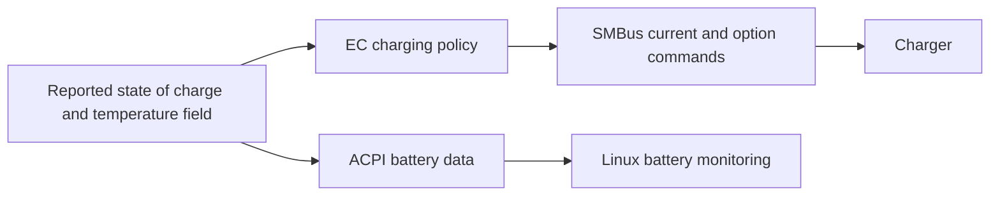

# Battery and charging

Battery monitoring works through Linux's normal power-supply interface.
**A 90% charge limit is not implemented.** Neither the BIOS charging-mode menu
nor the current EC host interface provides a verified percentage setter.

## Read battery information

```sh
minibookx-ctl --debug
cat /sys/class/power_supply/BAT0/uevent
```

The battery name can differ. Debug discovers the available power supplies and
reports their capacity, charging state, voltage, current/power and full/design
capacity when the kernel exports them. A missing field means unavailable, not
zero. Serial numbers are omitted from the report.

Some laptop drivers expose `charge_control_start_threshold` and
`charge_control_end_threshold` below the battery's sysfs directory. The tested
U300 does not offer a supported threshold control. Installing TLP or another
power manager cannot create a firmware interface that the kernel lacks.

The field names and units are defined in the
[Linux power-supply ABI](https://www.kernel.org/doc/Documentation/ABI/testing/sysfs-class-power).

## Charger identity

The firmware uses a charger on the EC's SMBus, separate from the CPU's I801
SMBus adapter. Its cached identification values match **Texas Instruments
BQ24780S**. This is a strong identification hint, not a fresh chip-ID result.
The separate device observed at address `0x64` is consistent with a Cellwise
CW2217-compatible fuel gauge; its command map and version response support that
interpretation, but the package marking was not read. A gauge that measures
charge and the charger that controls current are different devices.

| Item | Firmware interface | Interpretation |
|---|---|---|
| Charger address | 7-bit `0x09` on the EC SMBus | Not a Linux I2C bus number |
| Manufacturer ID | Command `0xFE`; cached value `0x0040` | Matches TI's documented ID |
| Device ID | Command `0xFF`; cached value `0x0030` | Matches BQ24780S |
| Charge current | Command `0x14` | Periodically programmed by EC firmware |
| Charge options | Command `0x12` | Also owned and refreshed by EC firmware |

The ID cache has no established per-read validity flag or timestamp. Doctor
therefore reports an EC/charger identity as unknown unless Linux exports one;
it does not open a debug interface or issue SMBus transactions to identify it.

Three reads of the existing cache returned bytes `00 40 00 30`. The active
firmware's initial packet table reads commands `0xFE/0xFF`; its normal cyclic
table does not. The bytes can therefore remain from initialization. Neither a
completed initialization phase nor a plausible nonzero cache proves a fresh,
successful transaction for each ID.

## Firmware charging path

The following locations refer to the
[identified active EC image](ec-firmware.md#image-identity-and-coverage).
They preserve a map for further analysis, not utility settings or an interface
for writing charge thresholds.

For firmware analysis, the known fields are:

| Firmware field | Location | Meaning |
|---|---|---|
| Internal state of charge | XDATA `0x050F` | Copied to the host battery-percentage field |
| Battery percentage | Host EC offset `0x93` | Telemetry overwritten by firmware; not a charge threshold |
| Charge-current target | Internal XDATA `0x05D4:0x05D5` | High-byte/low-byte word submitted to charger command `0x14` |
| Full-charge latch / timer | Internal XDATA `0x0814` / `0x0812:0x0813` | Firmware-owned state; timer tick duration unknown |
| Cached manufacturer ID | Internal XDATA `0x05D8:0x05D9` | High byte first; no freshness marker established |
| Cached device ID | Internal XDATA `0x05DA:0x05DB` | High byte first; no freshness marker established |

Internal XDATA locations are not normal host EC register offsets. The normal
host write path reaches a fixed host window, not the charger's internal current
target. These locations describe this firmware and are not supported utility
commands or writable configuration settings.

| Bank 0 CODE | Role |
|---|---|
| `0xAF0D–0xAF14` | Publish internal state of charge to XDATA `0x0493` / host offset `0x93` |
| `0xAB8F–0xAC38` | Recompute charging state and target current from state of charge and other gates |
| `0xA3FA–0xA424`, `0xB15D` | Increment/check the full-charge timer against 1800; this is a count, not a proved number of seconds |
| `0xB16A–0xB171` | Set the current target word to zero |
| `0xB0EF–0xB0F9` | Reinitialize charge-option target XDATA `0x05D0:0x05D1` to `0xE446` |
| `0x3320 / 0x3324`, repeated at `0x3344 / 0x3348` | Initialization packet entries for ID reads `0xFE / 0xFF` |
| `0x3340 / 0x335C` | WriteWord packet entries: command `0x14`, current-target buffer `0x05D4` |
| `0xACC5–0xACC9`, `0xCA0F` | Select the charger at wire address `0x12` (7-bit address `0x09`) on SMBus B |
| `0xCA23–0xCA47`, `0xC851–0xC892` | Transport word byte ordering: internal buffers store high byte first |

In the traced policy, state of charge at least 100 sets the full-charge latch.
After latching, a completed timer and state of charge at least 95 can request
zero current; falling below 95 clears the latch and timer. Additional gates and
a temperature-related field affect the result, so this is not an immediate
“stop at 100, start at 95” user setting. The sensor behind that internal
temperature field was not established by this analysis. These thresholds are
CODE constants, not an adjustable host table.

The [TI datasheet](https://www.ti.com/lit/ds/symlink/bq24780s.pdf), sections 7.3.3
and 7.6.1, documents charge-current control and the identification registers.
The chip accepts charge enable/current settings; it does not implement a
standalone “charge to 90%” policy.

## Why a charge ceiling needs more work

The EC recomputes its current/options targets and submits them again through
cyclic SMBus packet tables. A direct write to the charger could be overwritten;
no coordinated host ownership or return-to-automatic procedure was established.
The code path to zero current is useful evidence, but its electrical stop/resume
behavior has not been tested on this laptop.



| Possible approach | Missing piece |
|---|---|
| Set a Linux percentage threshold | No supported sysfs/ACPI threshold setter |
| Request charging off through EC | No coordinated host command and return-to-auto procedure found in the checked dispatcher/ACPI paths |
| Write charger current directly | Would compete with the EC's periodic writes |
| Change BIOS Normal/Fast Charging | Selects a charging policy, not a percentage ceiling |

The utility does not spoof battery capacity, alter internal firmware state or
race the EC with raw charger writes. A usable charge ceiling needs a verified
control path, reliable restoration after stop/sleep and an electrical
stop/resume test before it can become a service feature.

The bounded search covered the normal EC command dispatcher, its vendor-command
branches and the inspected ACPI battery methods. The host write window maps to
XDATA `0x0400–0x04FF`; the internal current target and latch are outside it.
Host fields named `CHGR` or battery percentage do not by themselves establish a
writable charging API. No coordinated SMBus proxy emerged from the checked
paths, but this is not proof that every alternate interface in the banked
firmware has been excluded.
