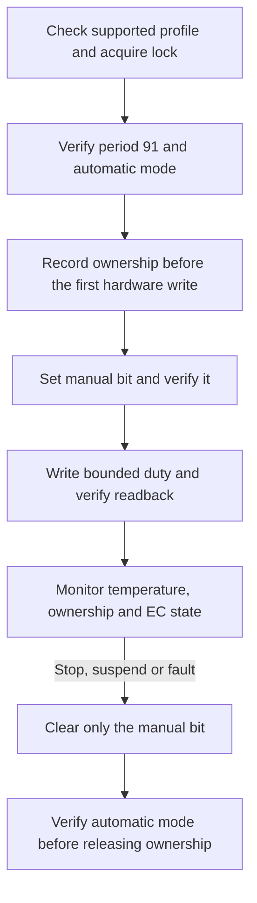

# EC fan interface

This reference describes the interface used by `minibookx-ctl` on the
[supported hardware and firmware](README.md). Register meanings depend
on the EC firmware; the controller model alone does not establish compatibility.
Use the [configuration guide](../configuration.md#fan-profiles) to change the fan
policy. Raw register access is not a user-facing feature.
The [firmware reference](ec-firmware.md) records the matching code identity,
address spaces and function offsets for developers investigating this revision.

## Bounded host interface

When managed fan control is enabled, the daemon accesses the EC through Linux
`ec_sys` at
`/sys/kernel/debug/ec/ec0/io`. Its backend permits reads of six offsets and writes
to only the duty register and the manual-control flag.
With [`fan_control = false`](../configuration.md#leave-the-fan-under-firmware-control),
the service leaves the fan to firmware and does not open this interface. Pending
recovery from an earlier managed session remains mandatory.

| EC offset | Meaning | Access used by the daemon |
|---|---|---|
| `0x4A` | PWM period; must read 91 | Read and verify |
| `0x4B` | Duty feedback in automatic mode; duty request in manual mode | Read; write 0 or raw 32–74 while manual |
| `0x4F`, bit 6 (`0x40`) | Manual-control flag | Read; change this bit only |
| `0x70` | CPU temperature from PECI GetTemp | Read for diagnostics |
| `0x76` / `0x77` | Firmware-derived fan-speed value, high / low byte | Read high–low–high; reject mismatched high bytes |

The EC temperature is quantized and retained between firmware updates. It does
not measure heatsink, case or room temperature. The fan policy uses Linux
`coretemp`; see [configuration](../configuration.md).

## Taking and releasing control

The ordering matters because automatic firmware continually updates the duty
register.

An I/O error can occur after a write has taken effect. Recovery therefore treats
the fan as potentially manual from before the first write. It preserves all
unrelated bits in `0x4F`. A failed release retains the ownership record so cleanup
can be retried.

Releasing manual mode resumes the firmware algorithm. It does not command full
speed, and the firmware may take several seconds to update its previous stage.
This release also assumes the firmware's separate internal debug override is
inactive; the normal host interface cannot check that state.

## PWM and speed feedback

For period 91, the interior PWM duty is approximately `raw / 92`. PWM percentage
is an electrical duty cycle, not a percentage of maximum RPM.

| PWM request | Raw duty | Actual duty | Supported use |
|---|---:|---:|---|
| Off | 0 | 0% | Fan stopped |
| 35% | 32 | 34.78% | Lowest accepted running duty; start from stopped verified |
| 40% | 37 | 40.22% | Accepted running duty |
| 50% | 46 | 50.00% | Accepted running duty |
| 70% | 64 | 69.57% | Accepted running duty |
| 80% | 74 | 80.43% | Highest accepted duty, including emergency requests |

The live backend accepts only 0 or raw 32–74. A 25% start has not been tested.
Values above the PWM period can have different electrical semantics: **raw 255
must not be treated as full speed**.

The speed field is derived by firmware and has not been calibrated against an
external tachometer. Typical readings on this unit were about 2,000–2,100 at raw
32 and 2,700–2,800 at raw 46. High–low–high reading reduces torn samples but does
not establish freshness. In particular, a single zero is not proof of a stall,
and every nonzero value is not necessarily valid RPM.

## Firmware fan curve

The stock automatic curve is stored in executable EC code. No supported command
to replace it in RAM has been established. The daemon therefore applies its own
policy while manual mode is active.

| Firmware stage | Lower threshold | Upper threshold | Raw duty |
|---|---:|---:|---:|
| 0 | 30°C | 45°C | 0 |
| 1 | 45°C | 55°C | 46 |
| 2 | 55°C | 62°C | 56 |
| 3 | 62°C | 72°C | 56 |
| 4 | 72°C | 80°C | 64 |
| 5 | 80°C | 92°C | 74 |
| 6 | 92°C | 105°C | 74 |

These are firmware stage thresholds, not settings accepted by the daemon. BIOS
active-trip temperatures and fan percentages belong to a separate ACPI policy;
they are not a demonstrated editor for this curve. See
[BIOS thermal settings](bios.md#fan-and-thermal-settings).

## Operational limits

Manual mode bypasses the ordinary firmware curve. No firmware lease, heartbeat
timeout or independent emergency fan takeover has been established. The daemon's
temperature checks and recovery reduce the risk of losing control, but cannot
recover an inaccessible EC or a hung kernel. CPU throttling is a separate
protection mechanism.

Run only one fan controller. The daemon's lock coordinates cooperating tools;
kernel EC transaction serialization does not make a multi-register sequence
atomic or protect against another raw writer. Process separation, monitoring and
recovery are described in [architecture](../design.md).
