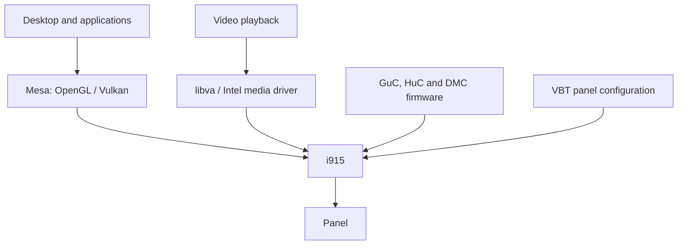

# Panel and graphics reference

For installation, use the [60 Hz guide](../guide/display.md). This page explains
the measured configuration and the limits of the graphics experiments.

## Panel timings

The tested panel is portrait-native 1200×1920 MIPI-DSI, using four lanes and
RGB888 / 24 bpp. Its exact part number and rated maximum refresh are unknown.
VBT supplies i915 with its fixed timing and panel commands.

The offline builder changes pixel clock and checksum while preserving resolution,
blanking totals, link format, lane count and panel commands. Refresh is pixel
clock divided by horizontal total and vertical total:

| Mode | Pixel clock | Horizontal total | Vertical total | Evidence |
|---|---:|---:|---:|---|
| Original 50 Hz | 138267 kHz | 1272 | 2174 | Startup corruption observed with stock i915 |
| 59.94 Hz | 165754 kHz | 1272 | 2174 | Boot and S3 passed with a downstream patched driver |
| 60 Hz | 165920 kHz | 1272 | 2174 | Stock-driver cold start and S3 passed on the matching panel |
| Above 60 Hz | — | — | — | 70 Hz corrupted the physical output; unsupported |

The [hardware reference](README.md) identifies the supported revision and
limitations. A screenshot or clean kernel log cannot establish
the physical output quality.

### Fixed mode and readiness

On Linux 7.2.11, this DSI path exposes one fixed VBT mode when i915 initializes.
A 60 Hz override replaces the selected 50 Hz timing rather than adding another
GNOME choice. Other VBT panel slots describe alternative panels, not extra
refresh modes. Live switching would need driver changes and correct clock
handling for each rate.

Changing pixel clock also changes escape-clock timing on this configuration.
A successful stock-driver boot is not proof that readiness was observed within
exactly 2500 µs: the polling helper can read after its nominal deadline. Generic
modelines, lower color depth and unrelated LVDS options are not substitutes for
a validated panel configuration. See the separate
[DSI readiness RFC](../../contrib/i915/README.md) for the driver investigation.

Sources: [DSI initialization](https://github.com/gregkh/linux/blob/v7.2.11/drivers/gpu/drm/i915/display/icl_dsi.c#L1992-L2003),
[fixed-mode validation](https://github.com/gregkh/linux/blob/v7.2.11/drivers/gpu/drm/i915/display/intel_panel.c#L397-L423),
[panel-orientation argument](https://github.com/torvalds/linux/blob/32c52ec87d6245ee2d12ed5dd509e40062939b50/Documentation/fb/modedb.rst#L78-L80).

### Builder and boot integration

`contrib/vbt/build_vbt.py` accepts only known complete VBT identities. Its outputs
are the 60 Hz and 59.94 Hz `.bin` files, a manifest, and an alternative
`vbt-modes.cpio` archive. The user guide uses the `.bin` with the distribution's
normal initramfs integration; the alternative archive is not required.

To investigate the older 59.94 Hz mode, its file is `chuwi-u300-59-94.bin`.
Use that filename consistently in the firmware location, inclusion rule and
`i915.vbt_firmware` argument from the display guide. Its recorded tests used a
patched driver; they do not qualify it as an alternative stock-driver fix.

The native inclusion rules persist across image regeneration. Limine's generated
image digests use BLAKE2b-512; its normal generator should maintain them.
Sources for inclusion semantics:
[mkinitcpio.conf](https://man.archlinux.org/man/mkinitcpio.conf.5.en),
[dracut.conf](https://github.com/dracut-ng/dracut-ng/blob/main/man/dracut.conf.5.adoc),
[initramfs-tools hooks](https://manpages.debian.org/trixie/initramfs-tools-core/initramfs-tools.7.en.html),
[copy_file helper](https://sources.debian.org/src/initramfs-tools/0.148.4/hook-functions/).
The documented hook accepts that helper's “already copied” result while
retaining failure for missing files and copy errors.

## Rendering and video decoding



Mesa provides rendering; the media driver provides video acceleration through
VA-API. The application must use an available decoding path. `vainfo` reports
capabilities, not whether a specific video is being decoded on the GPU.

### GuC, HuC and idle power

On the observed installation, GuC/HuC were running, DMC was loaded and RC6 render
idle was enabled. No extra `i915.enable_guc=3` override was needed. These features
have separate scheduling, media and display-power roles; none changes the panel's
DSI readiness deadline or refresh rate.

Sources: [i915 documentation](https://docs.kernel.org/gpu/i915.html),
[Mesa drivers](https://docs.mesa3d.org/systems.html),
[Intel media driver](https://github.com/intel/media-driver).

### Framebuffer compression

GNOME's observed framebuffer used XR30, a 10-bit-per-channel format, while the
panel link remained RGB888. i915 reported `FBC disabled: pixel format not supported`.
`i915.enable_fbc=1` cannot add XR30 support. Changing compositor buffer selection
has no established battery benefit on this laptop, so no workaround is recommended.
See [i915's format checks](https://github.com/torvalds/linux/blob/master/drivers/gpu/drm/i915/display/intel_fbc.c).

## Read-only inspection

Paths can vary by kernel. These inspect driver state without changing it:

```sh
lspci -nnk -s 00:02.0
cat /sys/module/i915/parameters/enable_guc
sudo cat /sys/kernel/debug/dri/0000:00:02.0/gt0/uc/guc_info
sudo cat /sys/kernel/debug/dri/0000:00:02.0/gt0/uc/huc_info
sudo cat /sys/kernel/debug/dri/0000:00:02.0/i915_fbc_status
sudo cat /sys/kernel/debug/dri/0000:00:02.0/i915_display_info
```

Inspect active timing while the screen is on. `modetest -M i915 -c`, when supplied
by the distribution, also reports connector properties such as panel mounting.
