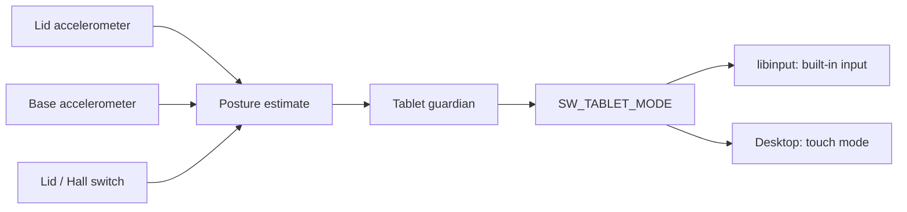

# Posture sensors

Technical reference for the [tablet-mode guide](../guide/tablet-mode.md).
The hardware-specific detector produces the standard Linux
`EV_SW/SW_TABLET_MODE` event. libinput and the desktop decide how to handle it;
the service does not intercept individual keyboard or touchpad events.
Suppression does not apply to every raw kernel consumer or virtual terminal.

## Detection

Two accelerometers provide lid and base gravity vectors. The lid/Hall switch
helps distinguish the closed boundary from a fully folded tablet.



| Condition | Behavior |
|---|---|
| Estimated angle ≥185° | Enter tablet mode after 500 ms stable classification |
| Estimated angle ≤175° | Exit tablet mode after stable classification |
| Between thresholds | Retain the prior mode |
| Movement | Delay a new transition |
| Hinge exactly vertical | Angle is unobservable; retain prior mode, defaulting to laptop at startup |
| Nearly closed with Hall still open | Can resemble the fully folded boundary |
| Closed lid | Clear tablet mode immediately |
| Invalid/missing gravity | Clear after 1.5 seconds |
| Sensor I/O or identity error | Request OFF immediately and fault for supervised recovery |

Sampling is normally every 250 ms. A gap longer than 750 ms resets pending
confirmation and motion history. These are gravity estimates, not measurements
from a calibrated hinge encoder. A physical 180° position may fall on either
side of the threshold gap.

Status reasons `HingeVertical` and `NearZeroHallOpen` describe those ambiguities.
Tilt away from a vertical hinge to obtain a new estimate. Briefly hold still
after moving or resuming.

## Lid notifications

The broker discovers the native ACPI `Lid Switch` by its name, physical identity,
host bus and `SW_LID` capability. It opens evdev read-only after forking both
children; neither child receives the descriptor. There is no input grab.

Initial setup and resume drain queued notifications and query the current switch
state with `EVIOCGSW`. Events are notifications, not values to replay over a newer
snapshot. `SYN_DROPPED` makes the state unknown until the next `SYN_REPORT` has
been discarded; only then is current state queried. An unfinished dropped
sequence remains unknown across resume. Unknown is never treated as open.

Normal operation reads this descriptor only when poll reports an event. It does
not repeatedly evaluate ACPI `_LID` or run a second ACPI fallback poller.
Missing or ambiguous devices fail startup. Disconnects and read/query failures
fault the service and trigger normal OFF/recovery, rather than silently assuming
an open lid. `--no-tablet` does not open a lid device.

After kernel or firmware updates, check lid opening, closing and resume again:
evdev depends on the kernel and firmware reporting those transitions. Disable
desktop sleep inhibitors, such as Caffeine, when checking lid-triggered sleep.
Linux documents the overflow protocol in
[input event codes](https://www.kernel.org/doc/html/latest/input/event-codes.html#ev-syn).

## Base-sensor initialization

The base sensor is found by its ACPI controller path and address `0x15`, not
a hardcoded Linux I2C bus number. On the supported profile, its ID register
`0x0E` reads `02`. CONTROL register `0x0D` can be `00` (awake) or `01`
(power-down) after a fresh boot.

The broker accepts only these known states. It journals an owned wake before
changing `01` to `00`, waits 500 ms and discards the first sample. It changes
no reset, range, interrupt or test setting. An already awake sensor is left
awake; a kernel-bound device is never unbound.

Stop and sleep restore the original state if the broker woke it. Resume
initializes a fresh estimate. The lease, locking and fault behavior are detailed
in [base-sensor recovery](../development/design.md#base-sensor-recovery).

## Desktop integration

GNOME's normal orientation must account for the physical mounting of the panel.
Use the [GNOME setup requirements](../guide/tablet-mode.md#setup) for the Mutter
fix and mounting hint. Without that hint, the tested connector reports `Normal`
rather than the required `Right Side Up`.

To inspect GNOME's rotation policy from the graphical session, without sudo:

```sh
gsettings get org.gnome.settings-daemon.peripherals.touchscreen orientation-lock
gdbus call --session --dest org.gnome.Mutter.DisplayConfig \
  --object-path /org/gnome/Mutter/DisplayConfig \
  --method org.freedesktop.DBus.Properties.Get \
  org.gnome.Mutter.DisplayConfig PanelOrientationManaged
```

`orientation-lock = true` means rotation is locked. `PanelOrientationManaged`
describes whether Mutter currently manages panel rotation. False in ordinary
laptop mode is expected; false while folded calls for checking the switch and
accelerometer. Unlocking rotation does not remove GNOME's posture requirement.

Sources: [Mutter mounting transform](https://github.com/GNOME/mutter/blob/51.1/src/backends/meta-output.c#L290-L312),
[orientation policy](https://github.com/GNOME/mutter/blob/51.1/src/backends/meta-monitor-manager.c),
[fix !4898](https://gitlab.gnome.org/GNOME/mutter/-/merge_requests/4898).
