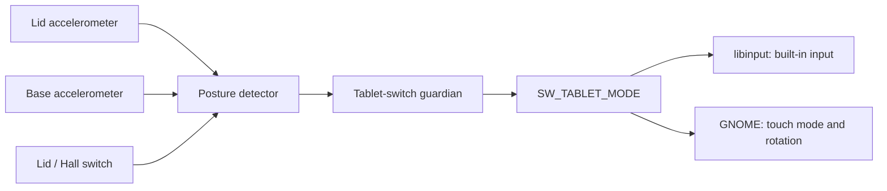

# Desktop and tablet mode

`minibookx-ctl` detects when the screen is folded behind the keyboard and publishes
the standard Linux tablet-mode switch, `EV_SW/SW_TABLET_MODE`. On GNOME/Wayland,
libinput disables the built-in keyboard and touchpad while the touchscreen and
external input remain available. GNOME handles screen rotation and the on-screen
keyboard; no desktop extension or rotation script is required.

The detector is enabled by default on the [supported hardware](hardware/README.md).
Install the distribution's [desktop prerequisites](distributions.md#runtime-packages)
and use the native session controls below. GNOME/Wayland is the tested desktop;
other environments need their own libinput, sensor and on-screen keyboard setup.
For correct orientation after unfolding, also check the panel's
[DRM mounting metadata](#sideways-display-after-unfolding). A supported Mutter
version alone is insufficient when the kernel reports the wrong panel mounting.

## Expected behavior

| Position | Built-in keyboard and touchpad | Screen behavior |
|---|---|---|
| Ordinary laptop | Enabled | Normal laptop orientation |
| Flat, around 180° | Previous mode retained inside the estimated 175–185° gap | No new transition inside that gap |
| Tent or screen folded behind the keyboard | Disabled after the posture settles | GNOME can rotate and show the on-screen keyboard |
| Folded tablet turned to portrait | Remain disabled | GNOME can rotate to portrait |
| Unfolded back into laptop position | Enabled after the posture settles | GNOME returns to normal laptop orientation |

Automatic rotation requires rotation lock to be off. To open the on-screen
keyboard, touch a text field while in tablet mode; folding alone need not open
it. Input suppression applies to the libinput desktop stack, not every raw
kernel consumer or virtual terminal.

## How detection works

Two accelerometers measure the lid and base orientation. The detector combines
their gravity vectors with the lid/Hall switch to estimate the hinge position.
This is a hardware-specific source for a standard Linux input event.



Tablet entry starts at 185° and exit at 175°, with 500 ms of stable classification.
The gap prevents repeated switching near a flat hinge. Moving samples delay new
transitions. Samples normally arrive every 250 ms. A gap longer than 750 ms
resets pending confirmation and motion history; missing time cannot count as a
stable posture. Missing or invalid gravity data clears tablet mode after 1.5
seconds, and a closed lid clears it immediately. A sensor I/O or identity error
requests tablet OFF immediately and faults the service for supervised recovery.

These angles are estimates from gravity, not a calibrated hinge encoder.
An approximately flat physical position can fall on either side of the
estimated boundary. If input remains disabled there, move the screen further
toward an ordinary laptop position and let the estimate settle.

The backend checks sensor identity and layout. It locates the base sensor by its
ACPI controller path and address rather than assuming a Linux I2C bus number.
The base sensor can start powered down after a fresh OS installation. On this
recognized revision, the broker can clear only its power-down bit, wait 500 ms
for startup and discard the first sample. It records the original state before
the write and restores it on stop or before sleep; resume checks it again. An
already awake sensor is left awake. Unknown control values are rejected, and a
kernel-bound device is never unbound. See [sensor recovery](design.md#base-sensor-recovery).

## Positions that need a little care

Gravity cannot resolve every possible hinge position. These limits affect how to
move the laptop when a transition does not register.

| Situation | What happens | What to do |
|---|---|---|
| Hinge held exactly vertical | The last confirmed mode is retained; startup defaults to laptop | Tilt the laptop slightly so the sensors can observe the hinge angle |
| Almost closed, but Hall still reports open | Can look like a fully folded tablet near the 0°/360° boundary | Open the screen further to restore unambiguous laptop geometry |
| Rapid movement | A new transition waits for stable samples | Hold the position still briefly |
| Missing sensor data | Tablet mode clears after the timeout | Check service logs; do not force a permanent keyboard disable |

In status output, `HingeVertical` means the angle cannot be measured in the
current position. `NearZeroHallOpen` means the detector is using the Hall-open
assumption at the folded boundary. Neither reason is a precise hinge measurement.

## Troubleshooting

```sh
minibookx-ctl --status
sudo journalctl -u minibookx-ctl.service -b
```

| Symptom | Check |
|---|---|
| Tablet mode does not activate | Confirm the service is running, fold beyond 180°, hold still, and inspect the `tablet` status record |
| Service reports a base-sensor startup error | Update to the current release, then inspect the journal if validation still fails; do not initialize registers manually |
| Input remains disabled after unfolding | Tilt away from a vertical hinge, then return to an ordinary laptop position |
| Input works, but the screen returns sideways | Check both [DRM panel mounting and the Mutter fix](#sideways-display-after-unfolding) |
| Auto Rotate is absent from quick settings | Open quick settings while folded; see [Auto Rotate](#auto-rotate-toggle) |

To stop the controller and request normal input and firmware fan control:

```sh
sudo systemctl stop minibookx-ctl.service
```

## Stop, faults and sleep

The tablet guardian owns the virtual switch separately from the policy worker
and hardware broker. Before normal device removal, it establishes tablet OFF,
writing an event unless the switch is already known OFF. Destroying the device
alone can leave input inhibited in libinput. Broker loss or an expired awake
heartbeat also requests OFF.

Suspend requests tablet OFF before sleep. Resume starts a fresh posture estimate
instead of replaying the old state. The default systemd watchdog uses SIGTERM
to allow this cleanup.

Allow a few seconds after wake before assessing the resumed posture. The
[sensor startup wait](design.md#base-sensor-recovery) and stable-pose
confirmation run again; a brief OFF state during that transition is expected.

An OFF acknowledgement confirms that the switch is known OFF through its live
descriptor, not that the compositor consumed an event. Killing the guardian
itself with SIGKILL or a kernel/input failure can prevent recovery. The full
process and recovery design is in
[architecture](design.md). A native firmware tablet switch could replace the
estimator, but [the BIOS options](hardware/bios.md#tablet-mode) do not currently
provide a verified replacement.

## Sideways display after unfolding

Mutter is GNOME's compositor. The panel is physically portrait-native, so normal
laptop orientation already includes an output transform. Mutter 51.0 could
discard that transform when leaving tablet mode, leaving the image sideways
after physical input returned.

**Mutter 51.1 contains fix !4898**, which restores logical normal orientation
while accounting for the panel mounting reported by DRM. Both that fix and
correct mounting metadata are required. On the tested U300, removing the manual
mounting hint leaves the immutable DRM `panel orientation` property at `Normal`.
That value does not describe this panel's physical mounting, so resetting the
logical transform to normal leaves the image sideways.

Check the connector's properties with the read-only `modetest -M i915 -c`
command, if the distribution supplies that tool. Use sudo only if access is
restricted. For this tested mounting, the required property is `Right Side Up`.
Follow the separate [manual panel-mount setting](../contrib/bootloaders/README.md#panel-mount-orientation)
to supply the standard DRM kernel argument and reboot. That setting applies
equally to stock 50 Hz and the experimental 60 Hz mode; the controller installer
does not apply it. Validate the physical image and fold/unfold behavior after
the change.

On another system, check the distribution changelog for the same fix; an older
version may carry a backport. Update the supported desktop stack through that
distribution, keeping GNOME Shell and Mutter coherent. For Arch/CachyOS:

```sh
sudo pacman -Syu
pacman -Q mutter
```

On the clean CachyOS installation checked on 22 October 2026, the CachyOS
repository still selected `mutter 51.0-3`, without the fix, while the already
enabled Arch `extra` repository supplied `51.1-1`. In that specific situation,
inspect `pacman -Si mutter extra/mutter` and review a full upgrade selecting the
fixed native package explicitly:

```sh
sudo pacman -Syu extra/mutter
```

This uses an existing CachyOS repository; it needs no AUR build or repository
priority change. Recheck the offered versions and dependencies rather than
assuming the same discrepancy exists on a later installation.

Use `apt policy mutter` on Debian/Ubuntu or `rpm -q mutter` on Fedora to inspect
the installed package. Save work, then log out and back in or reboot to load an
updated compositor. Do not mix distributions' desktop packages to obtain a
particular version number.

This fix handles unfolding orientation. It changes neither i915 readiness nor
refresh rate and does not enable auto-rotation in all postures. The installer
does not update or configure desktop packages.

Sources: [Mutter 51.1 release notes](https://github.com/GNOME/mutter/blob/51.1/NEWS),
[fix !4898](https://gitlab.gnome.org/GNOME/mutter/-/merge_requests/4898),
[Mutter's mounting transform](https://github.com/GNOME/mutter/blob/51.1/src/backends/meta-output.c#L290-L312).

## Auto Rotate toggle

GNOME 51 shows **Auto Rotate** in quick settings while Mutter manages panel
orientation, normally in folded tablet mode. Its absence in ordinary laptop
mode is expected. When folded, unlock rotation and turn the tablet. To inspect
the session policy, run without sudo in the graphical session:

```sh
gsettings get org.gnome.settings-daemon.peripherals.touchscreen orientation-lock
gdbus call --session --dest org.gnome.Mutter.DisplayConfig \
  --object-path /org/gnome/Mutter/DisplayConfig \
  --method org.freedesktop.DBus.Properties.Get \
  org.gnome.Mutter.DisplayConfig PanelOrientationManaged
```

| Result | Meaning |
|---|---|
| `orientation-lock = true` | Rotation is locked; unlock in quick settings |
| `PanelOrientationManaged = true` | Mutter manages the built-in panel's orientation |
| `PanelOrientationManaged = false` while folded | Check the controller's tablet state and accelerometer availability |

GNOME requires touch mode, an accelerometer and a built-in panel. Unlocking
rotation does not remove that posture gate. Use **Settings → Displays →
Orientation** for a fixed laptop orientation. The controller reports real
posture; it does not fake permanent tablet mode or install an extension to
bypass the desktop policy.

Plasma 6.6+ / Wayland offers **System Settings → Display & Monitor → Display
Configuration → Automatic**, with **Only when in tablet mode** optional. Clear
that restriction for native rotation in other postures. Plasma has not been
hardware-tested by this project; sensor support and input handling still need
verification on that session.

Sources: [GNOME availability checks](https://github.com/GNOME/gnome-shell/blob/51.1/js/misc/systemActions.js),
[Mutter orientation policy](https://github.com/GNOME/mutter/blob/51.1/src/backends/meta-monitor-manager.c),
[KScreen controls](https://github.com/KDE/kscreen/blob/Plasma/6.6/kcm/ui/Orientation.qml).

## On-screen keyboard

Fold the laptop, then touch an editable field. Folding alone need not open the
keyboard; GNOME also considers the last input device used. If it stays hidden,
check tablet status and touchscreen input first. Avoid globally forcing the
accessibility keyboard to hide a missing tablet switch.
